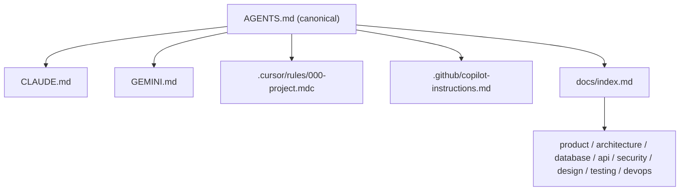

# Agent Compatibility

How this repository is meant to be used with AI coding agents, and what each tool
actually reads.

## 1. Canonical instruction file

[`AGENTS.md`](../../AGENTS.md) is the single source of truth. Everything else is an
adapter that points to it. If an adapter and `AGENTS.md` disagree, `AGENTS.md` wins.

## 2. Tool matrix

| Tool | File it reads | Loading | Notes |
| --- | --- | --- | --- |
| Claude Code | `CLAUDE.md` | automatic at session start | Also honours `AGENTS.md` when referenced |
| Gemini CLI | `GEMINI.md` | automatic | Referenced via `contextFileName` in some setups |
| Cursor | `.cursor/rules/*.mdc` | by `globs` / `alwaysApply` | `000-project` always applies; `010-python` only for Python files |
| GitHub Copilot | `.github/copilot-instructions.md` | automatic in the repo | Also picks up per-path `AGENTS.md` where supported |
| Generic agents | `AGENTS.md` | manual | The intended entry point for any other tool |
| Humans | `CONTRIBUTING.md` | manual | Same rules, human framing |

## 3. What each file contains

| File | Content | Size |
| --- | --- | --- |
| `AGENTS.md` | facts, commands, architecture map, invariants, where-to-change table, do-nots, definition of done | ~180 lines |
| `CLAUDE.md` | working style + "things that will surprise you" | ~60 lines |
| `GEMINI.md` | rules of engagement + repo quirks | ~40 lines |
| `.cursor/rules/000-project.mdc` | invariants and working agreement | ~45 lines |
| `.cursor/rules/010-python.mdc` | Python/async/aiogram/test patterns | ~60 lines |
| `.github/copilot-instructions.md` | condensed conventions for inline suggestions | ~55 lines |

The duplication is deliberate and small: adapters carry only what their tool loads.

## 4. Recommended context pack per task

| Task | Give the agent |
| --- | --- |
| Bug in a handler | `AGENTS.md` + the handler + `bot/ui.py` + related locale keys |
| New command | `AGENTS.md` + `docs/api/api-design.md` + a sibling handler |
| Schema change | `AGENTS.md` + `docs/database/migrations-strategy.md` + `migrations.py` + `models/__init__.py` |
| Provider work | `AGENTS.md` + `docs/architecture/decisions/ADR-003-ai-provider-abstraction.md` + `services/ai/*` |
| Docs | `AGENTS.md` + `templates/documentation/README.md` + the specific doc |
| Review | `prompts/review/19-code-review.md` + the diff |

## 5. Reusable prompts and skills

- [`prompts/`](../../prompts/README.md) — 23 executable prompts in seven phases. Each has
  role, inputs, task, constraints, output shape and verification.
- [`skills/`](../../skills/) — four procedure packages:
  `telegram-handler`, `database-migration`, `persian-localization`,
  `ai-provider-integration`. Each is a `SKILL.md` with frontmatter (`name`,
  `description`) usable by skill-aware agents.

## 6. Ground rules that prevent the usual agent failures

| Failure mode | Guard in this repo |
| --- | --- |
| Inventing APIs (`lang_text`, `ProviderResult`) | real surface documented in `AGENTS.md` §3 and the skills; verification steps grep for symbols |
| Registering a router after `chat` | invariant #4 + handler skill |
| Adding Alembic "because migrations" | ADR-002 + `AGENTS.md` §9 do-not list |
| Adding a web UI or FastAPI | product DNA boundary; `AGENTS.md` §9 |
| Claiming tests passed | `AGENTS.md` §10 definition of done; report actual output |
| Breaking Persian copy | parity test + localization skill |
| Destructive schema edits | migration skill refuses non-additive changes |
| Committing secrets | `AGENTS.md` §9; gitleaks workflow |

## 7. Limits you should expect

| Limit | Consequence |
| --- | --- |
| No API key or bot token in most agent environments | live Telegram/provider behaviour cannot be verified by the agent |
| Mermaid rendering varies by tool | diagrams are syntax-checked, not visually reviewed |
| No HTTP surface | agents cannot test the bot with `curl`; ChatEngine tests use a fake provider |
| SQLite only | advice assuming Postgres features will not apply |
| Single-process design | suggestions about horizontal scaling are out of scope |
| Persian quality | machine-written Persian needs native review before release |

## 8. Keeping the adapters in sync

When a rule changes:

1. Edit `AGENTS.md`.
2. Update only the adapters whose summary of that rule is now wrong.
3. Keep adapters under ~70 lines; move detail into `docs/`.
4. Re-run the link check, since adapters link into `docs/`.

No sync automation exists; the files are small enough to review by hand.
