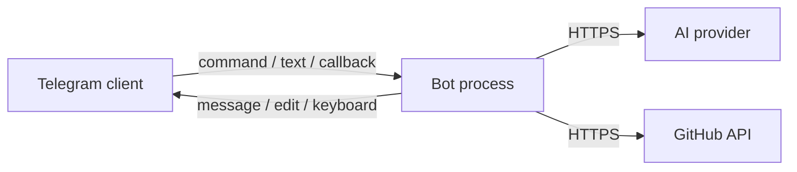

# API Design — Telegram Interface Contract

> **There is no HTTP API in this project.** The public interface is the Telegram Bot
> API surface: commands, inline-callback payloads, and free text. This document is
> therefore the *interface contract* for that surface — the equivalent of an OpenAPI
> spec for a bot. Machine-readable form:
> [`artifacts/api/telegram-interface.json`](../../artifacts/api/telegram-interface.json).

## 1. Interface model



| Concept | HTTP analogue | Implementation |
| --- | --- | --- |
| Command (`/menu`) | `GET /resource` | `@router.message(Command(...))` |
| Callback (`conv:open:12`) | `POST /action` with path id | `@router.callback_query(F.data.startswith(...))` |
| Free text | `POST /messages` | `chat.py` catch-all (registered **last**) |
| FSM step | multi-step form | `StateFilter` + `MemoryStorage` |
| Inline keyboard | hypermedia links | `InlineKeyboardMarkup` |
| `answerCallbackQuery` | 200 with empty body | toast feedback |

## 2. Command surface

| Command | Arguments | Auth | Effect | Success response | Failure responses |
| --- | --- | --- | --- | --- | --- |
| `/start` | — | any | create/find user; show home | welcome + main menu | — |
| `/menu` | — | any | home screen | menu | — |
| `/help` | — | any | usage help | help text + menu | — |
| `/lang` | — | any | language picker | inline FA/EN/KEEP buttons | invalid choice toast |
| `/cancel` | — | any | clear FSM state | cancelled + menu | "nothing to cancel" |
| `/new` | — | any | create conversation | new chat prompt | — |
| `/retry` | — | any | delete last assistant turn, regenerate | new reply or error | `chat.empty`, `errors.ai` |
| `/admin` | — | admin only | admin panel | panel + stats | silence (non-admins never see it) |
| `/block` | `<telegram_id>` | admin | block user | `common.saved` | hardcoded "Usage: /block <telegram_id>" when the id is missing; `common.unknown` when no such user |
| `/unblock` | `<telegram_id>` | admin | unblock user | `common.saved` | hardcoded "Usage: /unblock <telegram_id>"; `common.unknown` when no such user |

**Unknown commands** fall through to the text handler and are treated as chat input —
this is intentional (users type `/` accidentally); it is also a documented quirk.

## 3. Callback namespaces

Extracted from the handlers; prefixes are the router's contract.

| Namespace | Owner | Payloads | Notes |
| --- | --- | --- | --- |
| `menu:` | any | `menu:chat`, `menu:convs`, `menu:persona`, `menu:model`, `menu:tools`, `menu:memory`, `menu:prompts`, `menu:settings`, `menu:about`, `menu:profile` | navigation only |
| `home` | start | `home` | return to main menu |
| `lang:` | start | `lang:fa`, `lang:en`, `lang:keep` | UI language switch |
| `noop` | start | `noop` | button that must do nothing (shows toast) |
| `conv:` | conversations | `conv:list:<page>`, `conv:new`, `conv:open:<id>`, `conv:pin:<id>`, `conv:search`, `conv:exp:<id>`, `conv:sum:<id>`, `conv:rn:<id>`, `conv:arch:<id>`, `conv:unarch:<id>`, `conv:del:<id>`, `conv:delok:<id>` | ids are **always** re-checked for ownership |
| `pv:` | personality | `pv:presets`, `pv:style`, `pv:tone`, `pv:cr`, `pv:custom` | |
| `ps:` / `st:` / `tn:` / `cr:` | personality | `ps:<key>`, `st:<key>`, `tn:<key>`, `cr:<key>` | select preset |
| `cps:` | custom_personas | `cps:list`, `cps:new`, `cps:import`, `cps:default:<id>`, `cps:assign:<id>`, `cps:edit:<id>`, `cps:del:<id>`, `cps:exp:<id>` | |
| `mem:` | memory | `mem:toggle`, `mem:clear`, `mem:clearall` | |
| `mdl:` | model | `mdl:<provider>:<model>` | model switch |
| `tools:` | tools | `tools:summarize`, `tools:translate`, `tools:write`, `tools:explain`, `tools:coding`, `tools:custom` | opens FSM/input |
| `tc:` / `ts:` / `tt:` / `tw:` / `te:` | tools | target language / style / tone / length / language | |
| `pr:` | prompt_studio | `pr:list:<page>`, `pr:new`, `pr:cats`, `pr:cat:<name>`, `pr:run:<id>`, `pr:edit:<id>`, `pr:del:<id>`, `pr:exp:<id>` | |
| `set:` | settings | `set:rlang`, `set:emoji`, `set:mem`, `set:routing`, `set:privacy`, `set:reset`, `set:resetok` | destructive ones are two-step |
| `gh:` | developer | `gh:refresh`, `gh:repos:<page>`, `gh:popular`, `gh:repo:<name>` | public data only |
| `ab:` | about | `ab:dev`, `ab:bot`, `ab:support` | |
| `adm:` | admin | `adm:home`, `adm:stats`, `adm:limits`, `adm:health`, `adm:broadcast`, `adm:providers`, `adm:addprov`, `adm:delprov:<id>` | admin gate re-checked per callback |

**Rules**

1. Format `namespace:action[:identifier]`; identifiers are never trusted — the
   repository call includes `user_id`.
2. A namespace is owned by exactly one router; collisions are a review error.
3. Unknown payloads answer a toast and do nothing (no crash).

## 4. Request/response shapes

### 4.1 Command request

```json
{
  "update_id": 811000001,
  "message": {
    "message_id": 42,
    "date": 1763337600,
    "chat": {"id": 900000001, "type": "private"},
    "from": {"id": 900000001, "is_bot": false, "first_name": "Demo", "language_code": "fa"},
    "text": "/menu",
    "entities": [{"type": "bot_command", "offset": 0, "length": 5}]
  }
}
```

### 4.2 Callback request

```json
{
  "update_id": 811000002,
  "callback_query": {
    "id": "4382901234",
    "from": {"id": 900000001, "first_name": "Demo"},
    "message": {"message_id": 43, "chat": {"id": 900000001, "type": "private"}},
    "data": "conv:open:12"
  }
}
```

### 4.3 Response envelope (sendMessage)

```json
{
  "chat_id": 900000001,
  "text": "<b>Saved</b> ✅",
  "parse_mode": "HTML",
  "reply_markup": {"inline_keyboard": [[{"text": "Back", "callback_data": "home"}]]}
}
```

| Field | Rule |
| --- | --- |
| `text` | escaped, Markdown subset → HTML, ≤ 3500 chars per chunk |
| `parse_mode` | always `HTML`; on `TelegramBadRequest` retry without it |
| `reply_markup` | rebuilt from `lang` on every render; no callback state stored in the keyboard |
| `disable_web_page_preview` | set on AI replies |

### 4.4 Callback response (ack)

```json
{"callback_query_id": "4382901234", "text": "Not available", "show_alert": false}
```

Every callback handler acknowledges, even when it only edits the message — otherwise
the client shows a spinner.

## 5. Error envelope (user-facing)

Bots cannot return status codes, so errors are **localized messages** with a stable
key. See [error-handling](error-handling.md) for the full taxonomy.

| Condition | Localized key | Shape |
| --- | --- | --- |
| AI failure | `errors.ai` | `⚠️ {message}` + retry hint |
| Rate limited | `errors.rate_limited` | `⏳` + "wait a moment" |
| Daily capped | `errors.daily_limited` | `🚫` + the configured limit |
| Not found / not owned | none | empty `answer()` toast |
| Blocked user | *none* | update silently ignored |
| Admin misuse | `common.not_admin` | message or alert |

## 6. Idempotency and ordering

| Operation | Idempotent? | Notes |
| --- | --- | --- |
| `/start` | yes | `get_or_create` |
| `conv:open:<id>` | yes | read-only |
| `conv:del:<id>` | yes | second delete → empty toast, row already gone |
| `conv:pin:<id>` | toggles | repeated calls flip state (documented) |
| text message | **no** | each send is a new turn; a per-user lock serialises |
| `/retry` | no | deletes one assistant row, regenerates |
| `adm:broadcast` | no | one send per user, failures counted |

Telegram retries un-acked updates; every handler either acknowledges or completes a
state change, and DB writes are keyed so a duplicate `/start` cannot duplicate a user.

## 7. Versioning

- **Interface version:** implicit in the Bot API; aiogram `>=3.13,<4`.
- **Schema version:** `SCHEMA_VERSION` (currently 2) is internal; callbacks do not
  encode it.
- **Breaking change policy:** renaming a callback breaks old messages that are still
  in chat history (users can tap them). Mitigation: keep old prefixes as aliases for at
  least one release, or accept a toast error. Documented in
  [CONTRIBUTING](../../CONTRIBUTING.md).

## 8. Limits of the interface

| Constraint | Value | Mitigation |
| --- | --- | --- |
| Message text | 4096 chars | chunk at 3500 |
| Caption | 1024 chars | not used for long output |
| Callback data | 64 bytes | ids are integers; prefixes short |
| Inline keyboard rows | practical ~10 | lists are paginated (5/page) |
| Edits per message | "message is not modified" error | caught and ignored |
| Typing indicator | ~5 s | re-sent while the provider works |

## 9. Non-goals

No webhook endpoint, no HTTP REST API, no GraphQL, no OAuth, no SDK, no public status
endpoint. Anyone requiring an HTTP surface must add it deliberately (see
[open questions](../project/open-questions.md)).
