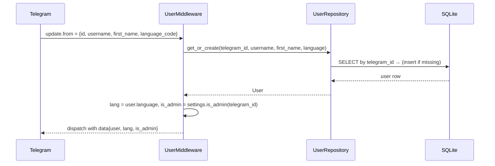

# Authentication & Authorization

There is no login, no password, no session token. Identity is delegated entirely to
Telegram; authorization is a two-tier model (user / admin) plus per-row ownership.

## 1. Identity model



| Property | Value |
| --- | --- |
| Subject identifier | `users.telegram_id` (unique) |
| Credential | Telegram's own client session — the bot never sees it |
| Trust anchor | `BOT_TOKEN` authenticates the bot to Telegram; Telegram signs updates |
| Session | none; every update carries `from` |
| First contact | `get_or_create` inserts the user with a default language |
| Language bootstrap | `from.language_code` mapped to `fa`/`en`, else `DEFAULT_LANGUAGE` |

**What the bot does *not* verify:** nothing about the user beyond Telegram's assertion.
If Telegram says the update came from id X, that is the identity. This is the correct
model for a bot and is why no password policy exists.

## 2. Authorization tiers

| Tier | How granted | Capabilities |
| --- | --- | --- |
| Anonymous | not possible | every update must carry `from` |
| User | any Telegram account | own chats, own settings, own personas/prompts/memory, tools, GitHub lookup |
| Blocked user | `users.is_blocked = true` | nothing — updates are dropped before dispatch |
| Admin | `telegram_id ∈ ADMIN_IDS` | admin panel, stats, limits, provider CRUD, broadcast, block/unblock |

### 2.1 Block gate

`UserMiddleware` returns `None` (short-circuits dispatch) when `user.is_blocked` is
true. No message, no error — a blocked user simply gets silence. This is deliberate:
replying would confirm the block.

### 2.2 Admin gate

`Settings.is_admin(telegram_id)` compares against the `ADMIN_IDS` env value (comma
separated integers). It is checked:

1. In `/admin` and `/block`/`/unblock` handlers.
2. **Again** in every `adm:*` callback handler — a non-admin who forges a callback
   payload (possible only by crafting an update, which requires bot-token access)
   still fails the check.

Non-admins never see admin keyboards, so the panel is not discoverable.

## 3. Ownership enforcement

Every user-scoped repository method takes `user_id`:

```python
conversation = await container.conversations.get(conv_id, user.id)
if not conversation:
    await cb.answer()          # silent toast: no resource, no information leak
    return
```

| Resource | Ownership check | Failure response |
| --- | --- | --- |
| conversation | `get(id, user_id)` | empty `answer()` (silent) |
| message | reached only through an owned conversation | — |
| persona | `get(id, user_id)` | empty `answer()` (silent) |
| prompt | `get(id, user_id)` | empty `answer()` or `common.error` toast |
| memory row | keyed by `user_id` | — |
| settings | `get_or_create(user_id)` | — |

**IDOR resistance:** callback payloads contain integer ids from the message the user
already received. A crafted payload for another user's id returns `not_found` because
the query filters on the caller's `user_id` — not because the UI hides it.

## 4. Trust boundaries

| Boundary | Direction | What crosses | Control |
| --- | --- | --- | --- |
| Telegram → bot | in | updates (identity, text, callback data) | `BOT_TOKEN`, aiogram validation, block gate |
| bot → Telegram | out | messages, keyboards | escaped HTML, chunking |
| bot → AI provider | out | prompts incl. user text and memories | API key in env; no user identifiers sent |
| bot → GitHub | out | public username | optional token; no scopes |
| bot → disk | local | SQLite incl. conversation text | filesystem permissions |

**Not present:** inbound webhooks (no signature validation needed), OAuth callbacks,
service-to-service auth, refresh tokens.

## 5. Secret handling summary

| Secret | Storage | Rotation | Exposure risk |
| --- | --- | --- | --- |
| `BOT_TOKEN` | `.env` | revoke via BotFather, restart | full bot takeover if leaked |
| `AI_API_KEY` | `.env` | reissue at provider, restart | billing abuse |
| `GITHUB_TOKEN` (optional) | `.env` | revoke on GitHub | read-only public data, low impact |
| runtime provider keys | `ai_providers.api_key` (plaintext) | delete/re-add | medium — see ADR-005 |
| `ADMIN_IDS` | `.env` | edit + restart | privilege escalation if wrong |

Full treatment: [secrets management](../security/secrets-management.md).

## 6. Authorization test matrix

| # | Actor | Action | Expected |
| --- | --- | --- | --- |
| A1 | user | open own conversation | allowed |
| A2 | user | open `conv:open:<other id>` | silent toast, no data |
| A3 | user | delete other's persona id | silent toast, row intact |
| A4 | non-admin | send `/admin` | `common.not_admin` message |
| A5 | non-admin | send `adm:stats` callback | alert `common.not_admin`, no data |
| A6 | blocked user | any message | silence, no DB write beyond middleware lookup |
| A7 | admin | `/block <id>` | target blocked on next update |
| A8 | admin | `/block notanumber` | hardcoded "Usage: /block <telegram_id>" (not localized — gap) |
| A9 | anonymous | update without `from` | ignored by framework |

Only A1/A7-style paths are covered indirectly today; handler-level tests are a
documented gap ([test-cases](../testing/test-cases.md)).
