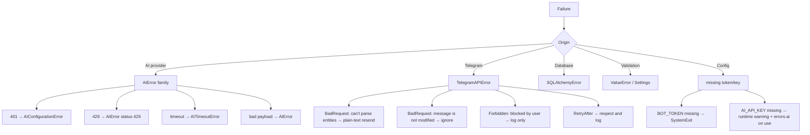

# Error Handling

## 1. Principles

1. **Never leave a user without feedback.** Every failure path ends in a localized
   message, a toast, or (for blocked users) intentional silence.
2. **Never leak internals.** No stack traces, no provider response bodies, no keys.
3. **Always record the failure.** Failed AI attempts are written to `usage_logs` with
   `success=0` and a truncated error.
4. **Degrade, don't crash.** A broken provider, GitHub outage or Telegram HTML
   rejection must not kill the polling loop.

## 2. Error taxonomy



## 3. Exception hierarchy

| Exception | Raised by | Carries | Handler behaviour |
| --- | --- | --- | --- |
| `AIError` | `openai_compat.py` | `message`, optional `status` | localized `errors.ai` |
| `AIConfigurationError` | provider on missing key | message | `errors.ai` + log at WARNING |
| `AITimeoutError` | provider on timeout | message | `errors.ai` |
| `TelegramBadRequest` | aiogram | description | plain-text fallback in `ui.py` |
| `TelegramForbiddenError` | aiogram | description | log; no retry |
| `IntegrityError` | SQLAlchemy | constraint name | repository pre-checks avoid the common cases |
| `ValueError` | repositories/validation | text | `errors.generic` in UI, log |
| `KeyError` (format) | localization | key | falls back to the key string |

## 4. HTTP/provider error mapping

| Upstream status | Meaning | `AIError.status` | User message | Retry? |
| --- | --- | --- | --- | --- |
| 401 / 403 | bad or missing key | raises `AIConfigurationError` | `chat.blocked` | no |
| 404 | wrong base URL / model | 404 | `errors.ai` | no |
| 429 | rate limited upstream | raises `AIError(429)` | `errors.ai` with detail | no (user decides) |
| 5xx | provider fault | raises `AIError(5xx)` | `errors.ai` with detail | `complete()` retries once |
| network error | DNS/reset | raises `AIError` | `errors.ai` with detail | once, then surface |
| timeout | slow model | raises `AITimeoutError` | `errors.ai_timeout` | once inside `complete()`, then surfaced |
| 200 with no choices | malformed | raises `AIError` | `errors.ai` with detail | no |

Failed attempts still write a `usage_logs` row so the admin health screen reflects
reality rather than only successes.

## 5. User-facing message catalogue

Keys live in `src/localization/{en,fa}.json` under `errors.*`:

| Key | When | Example (EN) |
| --- | --- | --- |
| `errors.ai` | provider failure (arg `detail`, 300 chars) | "⚠️ The AI provider returned an error: {detail}" |
| `errors.rate_limited` | per-minute limit | "⏳ Too many requests. Please wait a moment." |
| `errors.daily_limited` | daily cap (arg `limit`) | "🚫 You reached today's request limit ({limit})." |
| `errors.generic` | unexpected exception | "⚠️ Unexpected error. Please try again." |

Beyond `errors.*`, two namespaces carry user-facing failures: `common.error`
("something went wrong" toast for a no-op callback) and `common.not_admin`
(admin gate for both messages and callback alerts). A missing or foreign resource
is **not** reported: the callback answers with an empty toast so existence is not
confirmed. `/retry` with nothing to retry answers `chat.empty`.

Rules: sentence case, no stack details, no provider names, Persian strings use
correct ZWNJ, and each message implies the next action when one exists.

## 6. Logging contract

| Level | What | Include | Exclude |
| --- | --- | --- | --- |
| INFO | startup, migrations, provider refresh, broadcast summary | counts, versions | user text |
| WARNING | missing keys, GitHub failures, invalid settings values | reason | secrets |
| ERROR | provider failures, DB errors, handler exceptions | action, provider, model, status, latency, `str(exc)[:300]` | tokens, message bodies |
| DEBUG | request/response metadata (opt-in via `LOG_LEVEL`) | model, token counts | full prompts |

**No structured/JSON logging and no log shipping exist.** Logs go to stdout, collected
by Docker. Adding aggregation is TASK-302.

## 7. Retry and idempotency policy

| Operation | Retries | Backoff | Rationale |
| --- | --- | --- | --- |
| `provider.complete()` (tools) | 1 | 1 s linear | one-shot calls are cheap to retry |
| `provider.chat()` (conversation) | 0 | — | user is waiting; surface immediately |
| Telegram `sendMessage` | 0 (except HTML fallback) | — | platform retries are the user's choice |
| GitHub fetch | 0 | — | cached; user can press refresh |
| Migrations | 0 (idempotent re-run at next boot) | — | resume-on-restart |

## 8. Failure UX examples

**Provider down during chat**

```
User: explain closures
Bot:  ⚠️ The AI provider returned an error: upstream 500
      [ Retry ] [ Menu ]
```

No assistant row is written; the user's message is not stored (ADR-004). `/retry`
therefore answers `chat.empty` ("This conversation has no messages yet.") — the user resends.

**Rate limited**

```
Bot: ⏳ Too many requests. Please wait a moment.
     [ Menu ]
```

**GitHub unavailable**

The Developer screen renders profile placeholders and `gh.unavailable`, with a
`gh:refresh` button — no error toast.

**HTML rejected by Telegram**

`ui.py` catches `TelegramBadRequest`, resends the same text without `parse_mode`.
The user sees slightly plainer formatting, not an error.

## 9. Gaps

| Gap | Impact | Plan |
| --- | --- | --- |
| No global handler for unexpected exceptions | aiogram logs and drops the update; user may see nothing | add `dp.errors` handler (TASK-102) |
| No error tracking service | failures only visible in logs | TASK-302 |
| Failed chat turns are not recoverable from DB | user must retype | optional `pending_messages` table |
| `errors.generic` is rarely surfaced | some paths are silent | audit handler `try/except` coverage |
