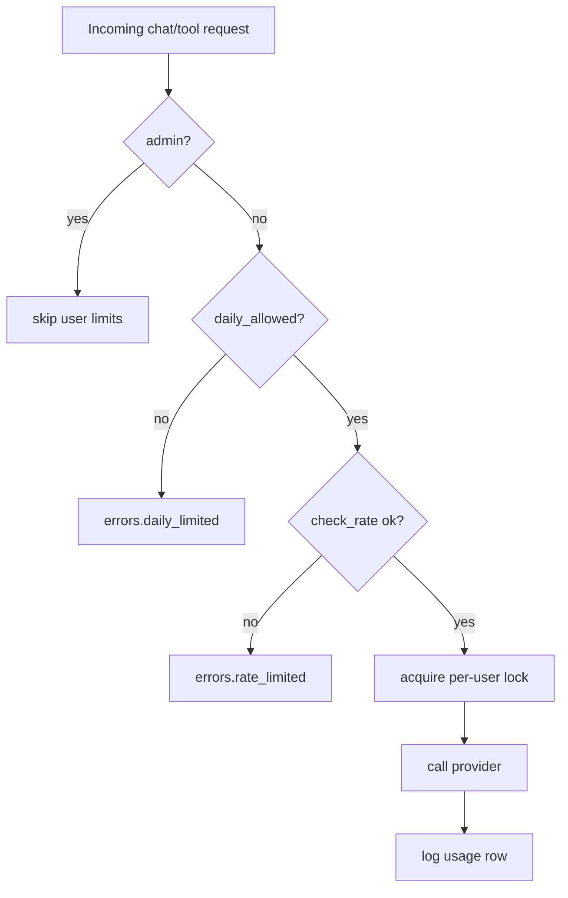

# Rate Limiting

Two independent limits protect the shared AI key and the operator's budget. Both are
enforced **before** any provider call.

## 1. Configured limits

| Variable | Default | Range enforced by `Settings` | Scope | Window |
| --- | --- | --- | --- | --- |
| `USER_RATE_LIMIT` | `20` | `1..10 000` | per Telegram user | 60 seconds (sliding) |
| `MAX_DAILY_REQUESTS` | `200` | `1..1 000 000` | per Telegram user | calendar day (server date via `date('now')`) |
| `MAX_CONTEXT_MESSAGES` | `20` | `2..200` | per request | not a limit, but bounds cost |
| `GITHUB_CACHE_TTL` | `900` | `60..86 400` | per GitHub login | seconds |

`UsageRepository.daily_allowed()` treats a value `<= 0` as unlimited, but `Settings`
rejects `0` (`ge=1`), so **an unlimited daily cap cannot be configured through the
environment today** — the repository branch is unreachable via config.

## 2. Enforcement flow



Order matters: the daily cap is checked first (cheaper, DB count) and the per-minute
window second (in-memory deque).

## 3. Per-minute window

```python
# UsageRepository.check_rate (conceptual)
now = time.monotonic()
bucket = self._buckets.setdefault(telegram_id, deque())
while bucket and now - bucket[0] > 60:
    bucket.popleft()
if len(bucket) >= limit:
    return False
bucket.append(now)
return True
```

| Property | Value |
| --- | --- |
| Storage | in-process dict of deques |
| Clock | `time.monotonic()` (immune to wall-clock jumps) |
| Granularity | exact sliding window, not fixed buckets |
| Reset | process restart clears all buckets |
| Multi-process | each process enforces its own quota (documented limitation) |

## 4. Daily cap

```sql
SELECT COUNT(*) FROM usage_logs
WHERE user_id = ? AND date(created_at) = date('now');
```

`usage_logs` is the single source of truth: the same rows feed admin statistics and
token totals, so there is no separate counter that can drift. The trade-off is that
*attempts* count, including failures — a provider outage can consume a user's quota.

## 5. Concurrency control

A per-user `asyncio.Lock` wraps the chat body. Two rapid messages are serialised
rather than racing; the second waits for the first provider call.

| Property | Value |
| --- | --- |
| Scope | one lock per Telegram id, created on demand |
| Held during | history load → provider call → persistence → send |
| Effect on limits | the second request's rate check runs after the first completes |
| Risk | a slow provider makes the user wait; bounded by the provider timeout |

## 6. Telegram-side limits (external, not enforced by us)

| Limit | Value | Our behaviour |
| --- | --- | --- |
| Message text | 4096 chars | chunk at 3500 |
| Global send rate | ~30 msg/s | broadcast sends sequentially and counts failures |
| Per-chat rate | ~1 msg/s sustained | replies are one message or a small sequence |
| `RetryAfter` on flood | seconds | logged; no automatic sleep-retry today |

Broadcast pacing is intentionally conservative: one send per user, no parallelism, no
retry storm. A failed send increments `failed` and the admin sees the count.

## 7. AI-provider limits (external)

| Scenario | Detection | Behaviour |
| --- | --- | --- |
| Provider 429 | `AIError.status == 429` | localized "try later"; no internal retry |
| Provider 5xx | status ≥ 500 | one retry in `complete()`, none in `chat()` |
| Token/context overflow | provider error | surfaced as `errors.ai` |
| Budget exhaustion | provider error (402/403) | surfaced as `errors.ai` |

There is **no global RPM cap** on outbound provider calls. With N users the bot can
open N concurrent calls. This is acceptable for a small deployment and is listed as a
scalability gap (§9).

## 8. Admin controls

| Control | Effect |
| --- | --- |
| `/block <id>` | user's updates are dropped in middleware (stronger than rate limiting) |
| `ADMIN_IDS` | admins bypass per-user limits |
| `MAX_DAILY_REQUESTS` env | changes the daily cap for everyone (minimum 1) |
| `USER_RATE_LIMIT` env | changes the per-minute cap for everyone |
| `adm:limits` screen | shows current effective values |

## 9. Known limitations

| Limitation | Consequence | Remedy |
| --- | --- | --- |
| In-memory bucket | restart refunds quota; multi-process multiplies it | shared store (TASK-202) |
| Failed calls count toward the daily cap | outage burns quota | count only successes (behaviour change, not scheduled) |
| No global concurrency cap | provider rate limit could be hit | add a semaphore (TASK-105) |
| No per-provider limits | one provider can be hammered | same |
| Broadcast has no rate smoothing | very large user bases may hit Telegram limits | batch with delays |
| No `RetryAfter` auto-wait | a flood error is logged and dropped | handle `TelegramRetryAfter` |

## 10. Verification status

- Limits are exercised indirectly (the chat handler calls the guard), but **no test
  asserts that the guard blocks** — recommended test T-22 in
  [test-cases](../testing/test-cases.md).
- The numbers above are read from `src/core/config.py`; they are configuration, not
  measured throughput.
