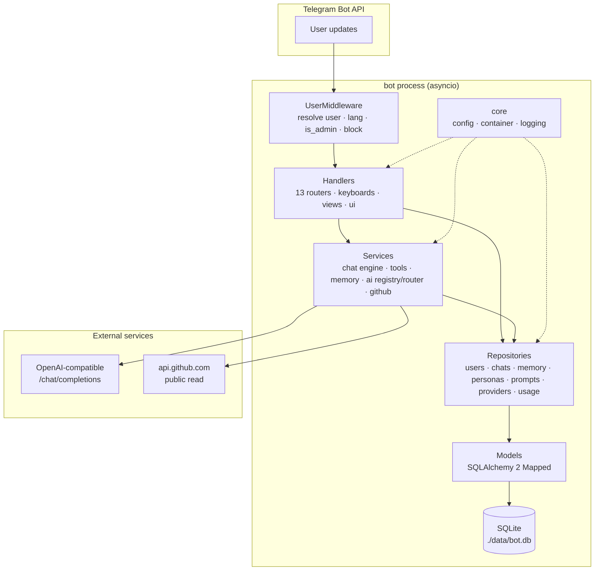
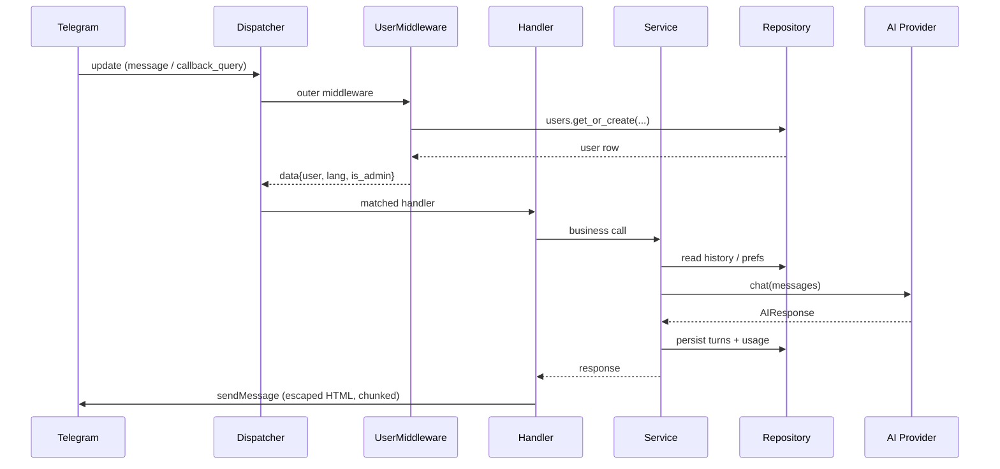
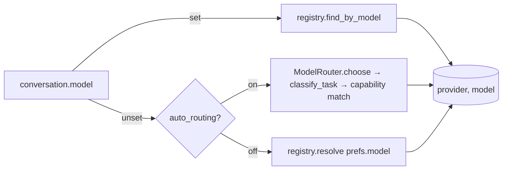
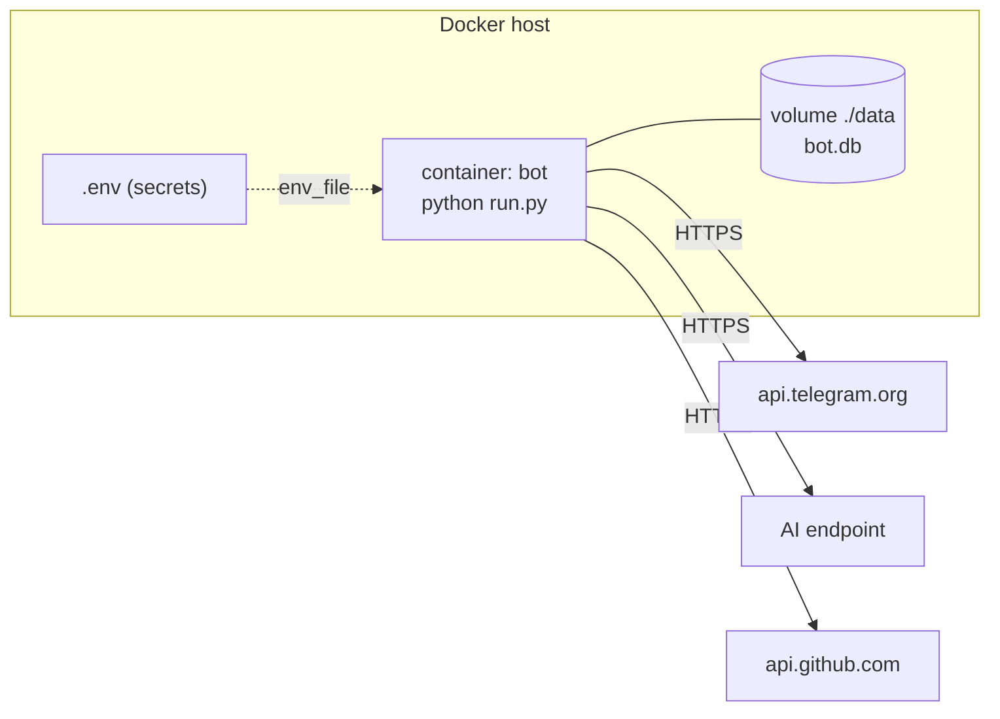

# System Architecture

> Implementation-grade description of what exists in `src/` today. Decisions and
> their rationale live in [`decisions/`](decisions/); the module inventory lives in
> [`repository-structure.md`](repository-structure.md).

## 1. Architectural overview

A **layered modular monolith** running as a single asyncio process:



**Key properties**

| Property | Value |
| --- | --- |
| Deployment unit | one container / one process |
| State | one SQLite file + in-memory FSM, rate buckets, GitHub cache |
| Interfaces | Telegram Bot API (in), HTTPS (out to AI + GitHub) |
| Trust boundaries | Telegram user ↔ bot process ↔ AI provider ↔ GitHub |
| Failure isolation | provider errors caught per request; GitHub errors degrade to fallback UI |

## 2. System boundaries

**Inside:** update routing, user identity resolution, conversation/history storage,
prompt composition, provider invocation, tool prompts, rate limiting, usage
accounting, localized rendering, keyboard navigation, admin operations.

**Outside (not our code):** Telegram platform (delivery, message limits, flood
control), the AI provider (model quality, latency, billing), GitHub (profile data),
the host (process supervision, disk, network).

## 3. Modules and responsibilities

| Module | Responsibility | May depend on | Must not depend on |
| --- | --- | --- | --- |
| `core/config.py` | Typed settings, validation, admin check | pydantic-settings | anything in `bot/`, `database/`, `services/` |
| `core/container.py` | Single composition point (declared attributes only) | typing | concrete modules (TYPE_CHECKING only) |
| `core/logging.py` | One-time stdlib logging setup | stdlib | app modules |
| `database/base.py` | Engine/session factory, `create_all` | models (lazy import) | handlers |
| `database/models` | Table definitions + relationships | SQLAlchemy | repositories, services |
| `database/repositories` | All SQL; ownership scoping; commits | models, base | services, handlers |
| `database/migrations.py` | Versioned additive DDL | base, models | handlers |
| `services/ai` | Provider interface, OpenAI-compatible client, registry, router | config, repositories (providers) | handlers, keyboards |
| `services/chat` | Context assembly, model resolution, prompt building, persistence, usage | ai, repositories, models, utils | keyboards |
| `services/tools` | One-shot prompt modes | chat engine | handlers |
| `services/memory` | Facade over memory repo | repositories | handlers |
| `services/github` | Public GitHub reads with TTL cache | httpx | database |
| `bot/handlers` | Parse update → call one service/repo → render | everything below | — |
| `bot/keyboards`, `bot/views`, `bot/ui` | Presentation only | localization, utils | repositories (direct) |
| `bot/middlewares` | Identity injection + block gate | container, localization | services |
| `utils` | Pure helpers (text, states) | stdlib, aiogram FSM types | database, services |

**Enforced conventions:** no SQL in `bot/`; no `aiogram` imports in `services/` or
`database/`; no direct session use outside repositories.

## 4. Communication patterns

### 4.1 Update flow (synchronous per update)



### 4.2 Provider resolution



### 4.3 Data ownership

Every user-scoped query carries `user_id`:

```python
conv = await container.conversations.get(conv_id, user.id)   # None if not owned
```

There is no admin "read any conversation" path — admins read aggregates only.

## 5. External integrations

| Integration | Direction | Auth | Failure handling | Rate limits |
| --- | --- | --- | --- | --- |
| Telegram Bot API | bi-directional long polling | bot token | aiogram exceptions logged; HTML send falls back to plain text | platform flood limits; broadcast paced |
| AI provider (`AI_BASE_URL`) | outbound | `Bearer AI_API_KEY` (or per-provider key) | `AIError` → localized message + `usage_logs.success=0` | HTTP 429 mapped to a user-visible "try later" |
| GitHub REST | outbound | optional `GITHUB_TOKEN` | `None`/`[]` → `gh.unavailable` | unauthenticated 60 req/h; TTL cache |

## 6. Data ownership map

| Table | Owner (conceptual) | Written by | Read by |
| --- | --- | --- | --- |
| `users` | user | middleware | middleware, admin, usage |
| `user_settings` | user | settings/personality/model handlers | chat engine, views |
| `conversations` | user | conversation handlers, chat | chat, conversations UI |
| `messages` | user (via conversation) | chat engine | chat engine, export, summary |
| `personas` | user | custom_personas handler | chat engine, list UI |
| `prompts` | user | prompt_studio handler | prompt studio |
| `user_memory` | user | memory handler/service | prompt builder |
| `ai_providers` | operator | admin handler | registry |
| `usage_logs` | operator | chat engine, tools, admin | stats |

## 7. Execution flows

### 7.1 Startup

1. `get_settings()` → `Settings` (cached).
2. `setup_logging(LOG_LEVEL)` — idempotent, `force=True`.
3. `validate_runtime()` warnings logged; missing `BOT_TOKEN` → `SystemExit`.
4. `bootstrap()`: `Database(url)` (creates the SQLite directory) → `run_migrations`
   → repositories → `ProviderRegistry.refresh()` → `ModelRouter` → `GitHubClient`
   → `ChatEngine` → `MemoryService` → `ToolService` → `container.mark_ready()`.
5. `Bot(token)`, `build_dispatcher()` (middleware + 13 routers in fixed order).
6. `dp.start_polling(...)`; on exit, close bot session and dispose the engine.

### 7.2 Shutdown

`finally` block closes the aiohttp session and disposes the SQLAlchemy engine.
No in-flight state is persisted (FSM is in memory — see §9).

## 8. Deployment topology



Single replica. No load balancer, no shared cache, no message broker.
Consequence: cannot run two replicas against one SQLite file safely.

## 9. Failure handling

| Failure | Detection | Behaviour | User sees |
| --- | --- | --- | --- |
| AI key missing/invalid (401) | `AIError(status=401)` | no history written; usage failure logged | `errors.ai` with key hint |
| AI rate limited (429) | status check | same | localized "try later" |
| AI timeout | `httpx.TimeoutException` → `AITimeoutError` | same | `errors.ai` |
| Provider returns malformed JSON | parse guard | `AIError` | `errors.ai` |
| Telegram rejects HTML | `TelegramBadRequest` | resend as plain text | plain-text reply |
| Edit has nothing to change | `"message is not modified"` | silently ignored | — |
| GitHub 403/429/404/timeout | status codes | empty result + cached fallback | `gh.unavailable` |
| DB error | SQLAlchemy exception | propagates; aiogram logs; update fails | silence + error log |
| Restart mid-flow | — | FSM lost | flow silently resets |
| Rate/daily limit exceeded | pre-call guards | no provider call | `errors.rate_limited` / `errors.daily_limited` |

## 10. Scalability considerations

| Axis | Current ceiling | Next step |
| --- | --- | --- |
| Users | thousands of rows — SQLite is fine for read-heavy 1:1 chat | Postgres when write contention appears |
| Concurrent AI calls | unbounded across users; serialised per user | add a global semaphore |
| Processes | **1** | shared rate store + Postgres + webhook |
| Message rate | Telegram-driven | broadcast pacing already sequential |
| Storage | `messages.content` grows unbounded | retention policy or export+prune |

## 11. Architecture trade-offs

| Trade-off | Chosen | Cost | Benefit |
| --- | --- | --- | --- |
| Monolith over services | one process | no independent scaling | trivial deploy/debug |
| `container` singleton over aiogram DI | module-level object | implicit dependency in handlers; harder to unit test handlers | small signatures, one construction point |
| Custom migrations over Alembic | 100-line runner | no downgrades/renames | no second schema authority |
| Regex routing | deterministic | misclassifies unusual phrasing | zero latency, zero cost |
| Persist-after-success | no partial history | user text lost on provider failure | no orphan user turns |
| In-memory FSM/limits | no extra service | lost on restart, not shared | no Redis dependency |
| Single OpenAI-compatible protocol | one request shape | cannot talk to Anthropic-style APIs natively | provider-agnostic via base URL only |

## 12. Known architecture debt

1. Handler-level dependency on the global `container` makes handler unit tests awkward
   (services/repositories are tested instead).
2. `ai_providers.api_key` in plaintext.
3. No WAL pragma on SQLite.
4. Two divergent summary/export paths that both read all messages into memory
   (`all_for_conversation`) — fine at current scale, not at 10⁵ messages.
5. `ChatEngine` is a large class (respond/regenerate/summarise/run_tool); splitting
   execution from summarisation is a candidate refactor **only if it grows**.

See [`HANDOFF.md`](../../HANDOFF.md) and the [roadmap](../product/product-roadmap.md)
for the ordered plan.
