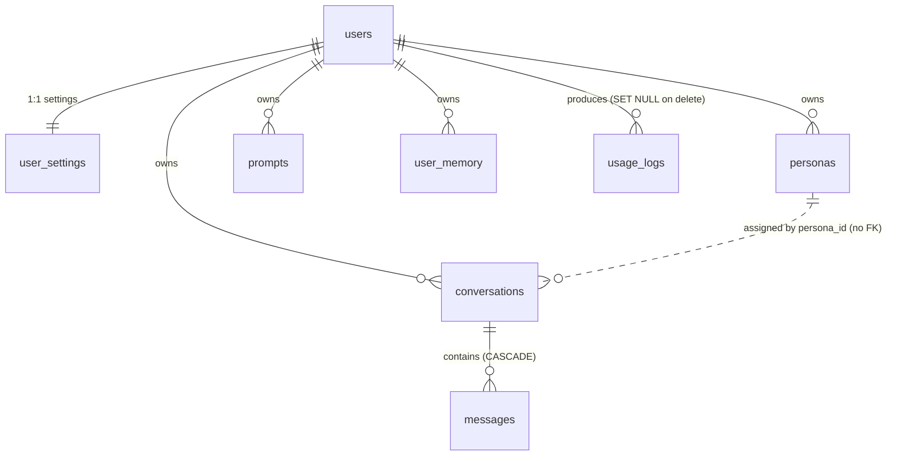

# Database Design

Engine: **SQLite** via `sqlite+aiosqlite` (ADR-002). ORM: SQLAlchemy 2 async.
Reference DDL: [`artifacts/database/schema.sql`](../../artifacts/database/schema.sql)
(validated by executing it against SQLite — 10 tables, `schema_version` 1–2).

## 1. Design goals

1. **Relational integrity for a conversational product:** users own conversations,
   conversations own messages.
2. **Ownership at the query level:** no table is readable across users without a
   `user_id` filter.
3. **One audit trail:** `usage_logs` is both the quota source and the cost record.
4. **Additive evolution:** new columns are safe; renames/drops are out of scope.
5. **No orphan rows on delete:** ORM cascades for user-owned data; `SET NULL` for
   audit rows.

## 2. Entity overview

| Table | Kind | Owner | Row lifecycle |
| --- | --- | --- | --- |
| `users` | identity | user | created on first update; retained until operator deletion |
| `user_settings` | preference | user | 1:1 with user; created lazily |
| `personas` | content | user | user CRUD; unique name per user |
| `conversations` | container | user | user CRUD; archived instead of deleted optionally |
| `messages` | content | user (via conversation) | append-only except delete/retry/clear |
| `prompts` | content | user | user CRUD |
| `user_memory` | content | user | upsert by key; clear |
| `ai_providers` | configuration | operator | admin CRUD |
| `usage_logs` | audit | operator | append-only |
| `schema_version` | metadata | system | written by the migration runner |

## 3. Relationships

**Note on `conversations.persona_id`:** it is an `Integer` column *without* a foreign
key constraint. Reason: the persona may be deleted while the conversation keeps its
history; the engine ignores an unresolvable id (`_persona_instructions` returns
`None`). A FK with `SET NULL` would be cleaner but requires a rebuild migration; this
is recorded as a known modelling compromise.

**Note on `user_settings.current_conversation_id` / `default_persona_id`:** also
plain integers, resolved through ownership-checked repository calls.

## 4. Table purposes and rules

### 4.1 `users`
- Identity anchor. `telegram_id` is the natural key (unique index); `id` is the
  surrogate used by all FKs.
- `language` holds the UI language (`fa`/`en`); it also seeds AI reply language via
  `auto`.
- `is_blocked` is checked in middleware before every handler.
- `last_seen_at` exists in the schema; it is **not** updated by the current
  middleware (only `get_or_create` writes on creation) — a known gap.

### 4.2 `user_settings`
- One row per user, created on first need (`get_or_create`), reset by Settings.
- Holds personality/style/tone/creativity, memory and emoji toggles, reply language,
  model/provider selection, active conversation, default persona, auto-routing.
- All enum-like values are free strings validated by fallback maps in
  `services/chat/prompts.py` (no CHECK constraints — an invalid value degrades to a
  default rather than rejecting a write).

### 4.3 `personas`
- User-authored system instructions with an emoji label and a default flag.
- `UNIQUE(user_id, name)` prevents duplicate names per user.
- `is_default` is maintained by `set_default()`/`clear_default()`; it is a UI
  convenience, not an invariant enforced by the DB (multiple defaults are possible if
  written outside the repository).

### 4.4 `conversations`
- `title` ≤ 120 chars; `summary` holds the last generated summary; `model` and
  `persona_id` are per-conversation overrides.
- `is_pinned` affects ordering; `is_archived` hides it from the list.
- `updated_at` is touched on every successful turn and drives list ordering.

### 4.5 `messages`
- `role` ∈ {`system`,`user`,`assistant`} by convention (no CHECK).
- Append-only during chat; `delete_last_assistant` removes one row for `/retry`;
  `clear` removes the whole conversation's messages.
- No per-message token counts; tokens live on `usage_logs`.

### 4.6 `prompts`
- Prompt Studio entries: `title` ≤ 100, `body`, `category` ≤ 50 (default `general`).
- No uniqueness: the same title may exist in different categories.

### 4.7 `user_memory`
- Key/value facts, `UNIQUE(user_id, key)`, upsert on conflict.
- Only the first 20 are injected (sorted by insertion/id order).

### 4.8 `ai_providers`
- Runtime OpenAI-compatible endpoints: `name` unique, `base_url`, `model`,
  `api_key`, `is_active`, `capabilities` (comma-separated task classes).
- Keys are plaintext — accepted risk (ADR-005).

### 4.9 `usage_logs`
- One row per AI attempt (chat, tool, summary, admin test).
- Fields: action, provider, model, success, error text, latency, prompt/completion
  tokens.
- Serves the daily quota count (`count_today`) and admin aggregates
  (`count_total`, `token_totals`).

### 4.10 `schema_version`
- `version` (PK), `description`, `applied_at`.
- Written by `run_migrations()` only.

## 5. Naming and type conventions

| Convention | Value |
| --- | --- |
| Table names | plural snake_case |
| Surrogate key | `id INTEGER PRIMARY KEY` |
| Timestamps | `created_at`, `updated_at` (UTC, `TimestampMixin`) |
| Booleans | `BOOLEAN NOT NULL` with model-level defaults |
| Enumerations | `VARCHAR(n)` + application-level fallback |
| Ownership | `user_id INTEGER NOT NULL` + FK CASCADE |
| Money/precision | none in the schema (no billing) |

## 6. Data volumes (estimates, not measurements)

| Table | Growth driver | Rough size per 1k messages |
| --- | --- | --- |
| `messages` | 2 rows per turn | ~2k rows, dominated by `content` text |
| `usage_logs` | 1 row per AI call | ~1k rows |
| `conversations` | user-created | tens |
| `user_memory` | manual facts | tens per user |

No pruning exists; a multi-year deployment should add a retention policy
(see [backup-recovery](../devops/backup-recovery.md) and roadmap TASK-203).

## 7. Security posture in the schema

- Ownership is enforced in queries, not row-level security (SQLite has none).
- No column encryption; the database file must be protected at the filesystem level.
- `usage_logs.error` may contain provider error text — never secrets by construction,
  but reviewed whenever an error path changes.

## 8. Known modelling gaps

| Gap | Impact | Remedy |
| --- | --- | --- |
| `persona_id` / `current_conversation_id` / `default_persona_id` without FKs | stale ids possible | resolve defensively (already done); add FK+`SET NULL` in a rebuild if wanted |
| `last_seen_at` never updated | inactive-user stats use `created_at` instead | update it in middleware (small change, not scheduled) |
| No `CHECK` constraints on enums | invalid values degrade silently | validation in services (current approach) |
| No index on `messages.created_at` | ordered scans per conversation | composite index `(conversation_id, id)` already implicit via PK ordering |
| No soft-delete | deletion is immediate | export before delete (feature exists) |
