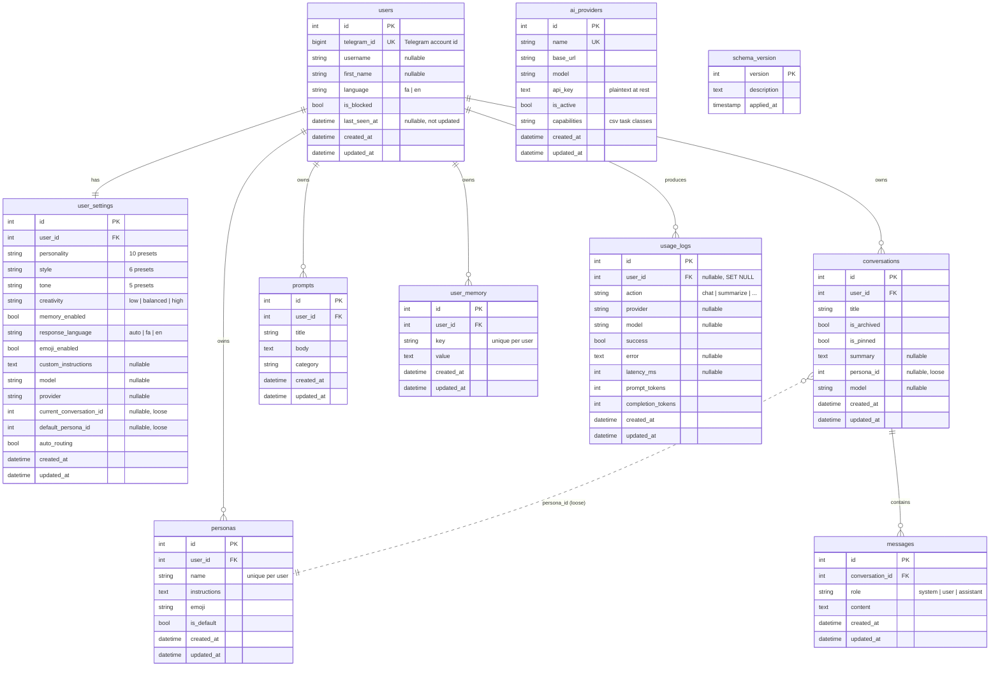
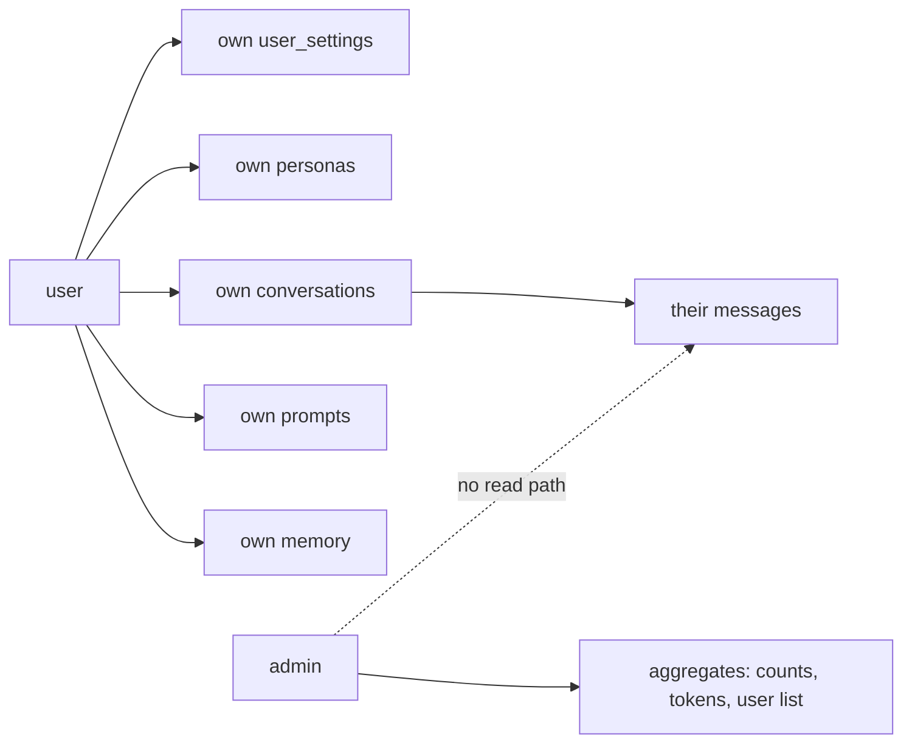

# Entity-Relationship Diagram

Source of truth: `src/database/models/__init__.py`. Raw Mermaid:
[`artifacts/diagrams/er.mmd`](../../artifacts/diagrams/er.mmd).

## 1. Full diagram

> `ai_providers` and `schema_version` have no relationships and are omitted from the
> relation arrows above for readability; they are present in the entity list.

## 2. Cardinality notes

| Relation | Cardinality | Delete behaviour |
| --- | --- | --- |
| users → user_settings | 1:1 | ORM cascade; row recreated on next need |
| users → personas | 1:N | CASCADE (ORM + `ondelete`) |
| users → conversations | 1:N | CASCADE; messages follow |
| conversations → messages | 1:N | CASCADE |
| users → prompts | 1:N | CASCADE |
| users → user_memory | 1:N | CASCADE |
| users → usage_logs | 1:N | `SET NULL` — audit rows survive user deletion |
| conversations → personas | N:0..1 | **no FK**; dangling id is ignored at read time |

## 3. Ownership map (who may read what)

Admins can block users and see aggregates; there is **no admin path to read another
user's messages**.

## 4. Invariants

1. Every `messages.conversation_id` resolves to a conversation owned by the same user
   as the message's author (enforced by always fetching the conversation with
   `user_id`).
2. `users.telegram_id` is unique.
3. `personas (user_id, name)` is unique.
4. `user_memory (user_id, key)` is unique.
5. `ai_providers.name` is unique.
6. `usage_logs` rows are never updated except by nothing — treat them as immutable.

## 5. Index summary

| Index | Table | Purpose |
| --- | --- | --- |
| `ix_users_telegram_id` (unique) | users | identity lookup on every update |
| `ix_user_settings_user_id` (unique) | user_settings | 1:1 guarantee + lookup |
| `ix_conversations_user_id` | conversations | list/ownership |
| `ix_messages_conversation_id` | messages | history load |
| `ix_personas_user_id` | personas | list |
| `ix_prompts_user_id` | prompts | list |
| `ix_user_memory_user_id` | user_memory | prompt injection |
| `ix_usage_logs_user_id` | usage_logs | quota count, stats |
| implicit PK index | all | `id` lookups, ordering |
