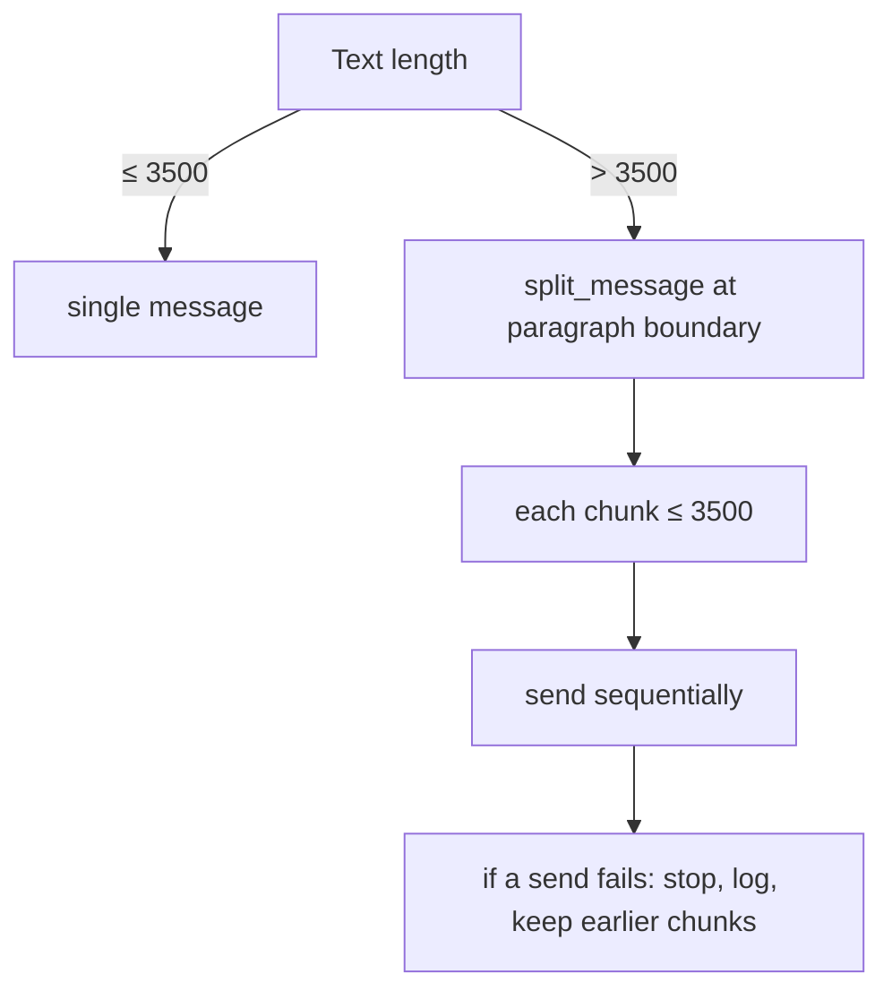

# Responsive & Cross-Client Design

There is no viewport to control. "Responsive" here means: **the same message must
survive every Telegram client, screen size, language direction and text length.**

## 1. Client matrix

| Client | Constraint that shapes design |
| --- | --- |
| Android | narrow width on phones; long button labels wrap awkwardly |
| iOS | similar width; emoji rendering differs slightly |
| Desktop | wide window; long lines are fine but lists look sparse |
| Web (web.telegram.org) | resizable down to ~320 px; scrolls long messages |
| Third-party (e.g. macOS native) | may not support some entities or custom emoji |

**Rule:** design for the narrowest (≈320 px). If a label fits there in Persian, it fits
everywhere.

## 2. Text-length budgets

| Element | Budget (EN) | Budget (FA) | Enforcement |
| --- | --- | --- | --- |
| Button label | 20 chars | 22 chars (wider glyphs) | review + catalogs |
| Title line | 40 chars | 40 chars | truncation helper for titles |
| List item | ~45 chars incl. count | ~45 | conversations are user-titled; long titles truncated |
| Message body | 3500 chars/chunk | same | `split_message` |
| Error line | 80 chars | 80 | copy review |

Persian is typically 10–20% wider; budgets are set with that margin already applied.

## 3. Long-content behaviour

| Content | Behaviour |
| --- | --- |
| AI answer | split, no "part 1/2" prefix (adds noise; order is clear) |
| Code block longer than 3500 | split mid-block (documented limitation: the fence may not close) |
| Conversation export | sent as a file-like text message sequence |
| Titles | truncated with `…` |

## 4. Direction (RTL / LTR)

| Concern | Handling |
| --- | --- |
| UI direction | determined by the client's language, not by our text — we cannot force it |
| Persian copy | written RTL-first: verb/object order natural, no leading Latin punctuation |
| Mixed content | Latin words inside Persian text are isolated by word boundaries; avoid wrapping Latin in Persian parentheses |
| Arrows | place `→`/`←` after the label in FA, prefix in EN |
| Lists | numbered with `1.` in both, which renders left-aligned in FA clients |
| Code | always LTR; fenced blocks render LTR inside RTL messages in all major clients |
| ZWNJ | mandatory in `میشود`, `چتها`, `بهروزرسانی`; missing ZWNJ is a review defect |

## 5. Emoji and glyphs

| Concern | Handling |
| --- | --- |
| Emoji width | always followed by a space, never used as a separator between words |
| Fallback | if a glyph is missing, the label text still carries the meaning |
| Admin/status badges | single emoji at the end of a line |
| No custom emoji | they require premium/`custom_emoji` entities and may not render |

## 6. Pagination and navigation at small sizes

- Page size 5 keeps the list plus 4 navigation buttons within one screen.
- Navigation row appears only when `total > page_size` (no dead arrows).
- No nested submenus beyond two levels; deep features use list → detail → action.

## 7. Testing the design across clients (manual, not automated)

| # | Check | Why |
| --- | --- | --- |
| 1 | Send the main menu in FA and EN on a phone-width client | labels wrap or truncate |
| 2 | Send a 5000-char AI reply | chunking and ordering |
| 3 | Send a reply containing a fenced code block | fence rendering inside RTL |
| 4 | Open a conversation with a 120-char title | truncation |
| 5 | View the admin panel on mobile | 12 buttons fit? |
| 6 | Toggle emoji off and re-render | readability without glyphs |

**Status:** none of these has been executed by the documentation author (no Telegram
client in this environment). Treat the table as a release checklist, not as evidence.

## 8. Constraints that cannot be designed around

| Constraint | Consequence |
| --- | --- |
| No custom CSS/fonts | typography is the platform's |
| No viewport detection | cannot adapt layout per device |
| Client-side text selection/copy | users can copy prompts — intended |
| Message editing limits | heavy edits can hit "message is not modified" (caught) |
| No images in this product | no alt-text or caption design needed |
