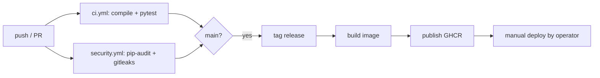

# CI/CD

## 1. Status (read this first)

The workflows described here are **provided by this documentation package** and have
**never executed** in this repository. There is no build badge, no release automation,
and no deployment pipeline. Nothing in this document is evidence that CI passes.

## 2. Workflows

### 2.1 `.github/workflows/ci.yml`

| Property | Value |
| --- | --- |
| Triggers | `push` to `main`, `pull_request`, manual |
| Runner | `ubuntu-latest` |
| Python | 3.12 (matrix: only 3.12) |
| Steps | checkout → setup-python → pip cache → install `requirements-dev.txt` → `compileall` → `pytest` |
| Duration (expected) | < 60 s |

```yaml
# key steps (abridged)
- uses: actions/checkout@v4
- uses: actions/setup-python@v5
  with: { python-version: "3.12", cache: pip }
- run: pip install -r requirements-dev.txt
- run: python -m compileall -q src
- run: pytest -q
```

No secrets are required: the suite never touches the network or Telegram.

### 2.2 `.github/workflows/security.yml`

| Property | Value |
| --- | --- |
| Triggers | `push`, `pull_request`, weekly schedule |
| Jobs | `pip-audit` on `requirements.txt`, `gitleaks` secret scan |
| Secrets | none (gitleaks needs full history: `fetch-depth: 0`) |
| Failure policy | fails the run on a detected secret; dependency findings are reported |

## 3. What CI does not do

| Not present | Consequence |
| --- | --- |
| Lint (ruff/flake8) | style drift is caught only in review |
| Type check (mypy) | typing regressions are not gated |
| Coverage threshold | coverage is not measured |
| Build/publish image | no registry push, no tags |
| Deploy | no environment, no secrets, no approval flow |
| Versioning/changelog check | manual |

## 4. Intended pipeline (target)



Deployment remains **manual and operator-driven** by design (ADR-006). Auto-deploy is
not part of the product.

## 5. Adding a check

1. Put it in `ci.yml` after `pytest` so failures are cheap to diagnose.
2. Never require a real Telegram token or AI key in CI.
3. If a check needs secrets, it belongs in a separate workflow with an explicit
   permission block and no `pull_request_target` trigger.

## 6. Local equivalent

```bash
python -m compileall -q src
pytest -q
pip install pip-audit && pip-audit -r requirements.txt    # if you want the security job locally
```

## 7. Branch and merge conventions

| Rule | Detail |
| --- | --- |
| Default branch | `main` |
| Direct pushes | allowed for the maintainer; PRs preferred for anything non-trivial |
| Merge style | squash preferred (one change = one commit on `main`) |
| Commit format | imperative subject, optional body explaining *why* |
| Tags | `vMAJOR.MINOR.PATCH` matching `BOT_VERSION` |

## 8. Release checklist (manual today)

```markdown
1. [ ] pytest -q passes
2. [ ] BOT_VERSION bumped in .env.example and Settings default
3. [ ] CHANGELOG.md updated
4. [ ] docs/traceability updated for new requirements
5. [ ] tag vX.Y.Z and push
6. [ ] docker compose build && up -d on the host
7. [ ] logs show migrations applied and polling started
```
