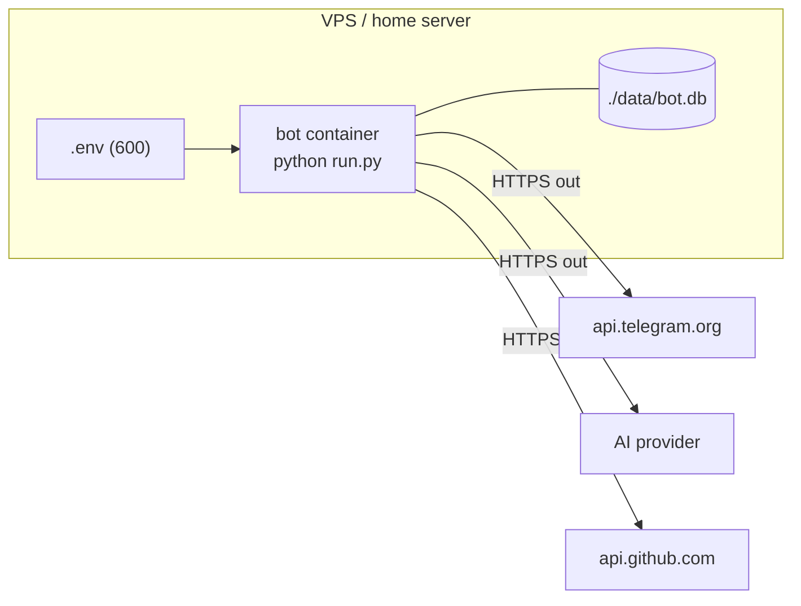

# Deployment

Decision record: [ADR-006](../architecture/decisions/ADR-006-deployment-and-runtime.md).
Target: one container, long polling, SQLite on a volume.

## 1. Topology



No inbound ports. No reverse proxy. No TLS certificate.

## 2. Requirements

| Item | Minimum |
| --- | --- |
| OS | any Linux with Docker + Compose v2 |
| CPU/RAM | 1 vCPU / 512 MB is sufficient for a small bot (not measured) |
| Disk | ~300 MB image + DB growth |
| Network | outbound HTTPS only |
| Telegram | bot token from @BotFather |
| AI | an API key for an OpenAI-compatible endpoint |

## 3. Docker Compose deployment (recommended)

```bash
git clone https://github.com/mohammadhossein-asadi/telegram-ai-assistant.git
cd telegram-ai-assistant

cp .env.example .env
chmod 600 .env
# edit: BOT_TOKEN, AI_API_KEY, AI_BASE_URL, AI_MODEL, ADMIN_IDS

docker compose build
docker compose up -d
docker compose logs -f --tail=50 bot
```

Expected log sequence:

```
INFO  database migrations applied (schema_version=2)
INFO  providers loaded: 1
INFO  bot started (long polling)
```

Verify in Telegram: `/start` → menu appears. `/admin` (as an admin id) → panel.

### Compose specifics

| Setting | Value | Why |
| --- | --- | --- |
| `restart: unless-stopped` | | survives host reboot |
| `env_file: .env` | | secrets outside the image |
| `./data:/app/data` | | persists `bot.db` across rebuilds |
| `DATABASE_URL` override | `sqlite+aiosqlite:///./data/bot.db` | ensures the volume path |

## 4. Plain Docker

```bash
docker build -t telegram-ai-assistant .
docker run -d --name bot \
  --restart unless-stopped \
  --env-file .env \
  -v "$PWD/data:/app/data" \
  -e DATABASE_URL="sqlite+aiosqlite:///./data/bot.db" \
  telegram-ai-assistant
```

## 5. Bare-metal / systemd

```ini
# /etc/systemd/system/telegram-ai-assistant.service
[Unit]
Description=Telegram AI Assistant
After=network-online.target

[Service]
WorkingDirectory=/opt/telegram-ai-assistant
EnvironmentFile=/opt/telegram-ai-assistant/.env
ExecStart=/opt/telegram-ai-assistant/.venv/bin/python run.py
Restart=always
User=botuser
Group=botuser

[Install]
WantedBy=multi-user.target
```

`requirements.txt` must be installed into `.venv` and `data/` must be owned by
`botuser`.

## 6. PaaS

Any host that runs a long-lived process from a Dockerfile works (Render, Railway, Fly,
a VPS with Coolify). Requirements:

1. Persistent disk mounted at `/app/data` (SQLite does not survive ephemeral
   filesystems).
2. **Exactly one instance.** Two instances poll the same bot token and conflict; two
   writers on one SQLite file corrupt assumptions.
3. Environment variables set in the platform's secret store.

Serverless platforms that cannot keep a process alive or a local file are **not
supported**: long polling needs a long-lived worker and SQLite needs a disk.

## 7. First-run checklist

```markdown
[ ] .env has BOT_TOKEN, AI_API_KEY
[ ] ADMIN_IDS contains your Telegram id
[ ] /start works from a second account
[ ] a chat message returns a reply
[ ] /admin shows stats
[ ] data/bot.db exists and is non-zero
[ ] logs contain no CONFIG warnings other than expected ones
```

## 8. Upgrades

```bash
docker compose exec bot sqlite3 /app/data/bot.db ".backup '/app/data/pre-upgrade.db'"
git pull
docker compose build && docker compose up -d
docker compose logs --tail=50 bot        # confirm migrations + polling
```

Migrations are additive and idempotent (ADR-002). If the new version fails to boot,
restore the backup and pin the previous image tag.

## 9. Rollback

```bash
docker compose down
cp data/pre-upgrade.db data/bot.db
# checkout the previous tag, rebuild, up
```

There is no automatic rollback and no blue/green environment.

## 10. Hardening gaps in the current image

| Gap | Impact | Temporary mitigation |
| --- | --- | --- |
| Runs as root | container escape has more impact | add `user: "1000:1000"` and chown `data/` |
| No `HEALTHCHECK` | orchestrators cannot tell liveness | rely on `restart` + log monitoring |
| Base image not digest-pinned | silent base changes on rebuild | pin `python:3.12-slim@sha256:…` |
| No read-only root filesystem | wider write surface | `read_only: true` + tmpfs for `/tmp` |
| No resource limits | one bot can starve the host | `deploy.resources.limits` |

These are honest deficiencies of the shipped files, not of this guide. Fixing them is
a small PR (listed in the roadmap as polish, not scheduled).

## 11. What is *not* verified

No deployment on a real host was performed while producing this documentation: there
is no bot token or provider key in this environment. The steps above reflect the
repository's actual files (`Dockerfile`, `docker-compose.yml`, `run.py`), but the
"first-run checklist" has not been executed here.
