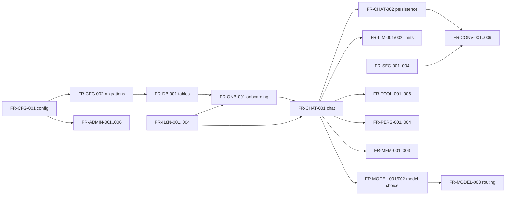

# Functional Requirements

Identifiers are stable and referenced from user stories, test cases, the
traceability matrix (`manifest/requirements-traceability.csv`) and ADRs.
"Source" points at the implementing symbol; every row is verified against the
code, not aspirational.

Priority: **P0** critical for the product to exist · **P1** core value ·
**P2** important · **P3** future.

---

## 1. Configuration & startup

| ID | Requirement | Behaviour / rules | Validation & errors | Source | Pri |
| --- | --- | --- | --- | --- | --- |
| FR-CFG-001 | The application must load configuration from environment and `.env` | All settings typed in `Settings`; unknown keys ignored; `case_sensitive=False` | `validate_runtime()` returns human-readable problems list; missing `BOT_TOKEN` raises `SystemExit` before polling | `src/core/config.py`, `src/bot/main.py` | P0 |
| FR-CFG-002 | The schema must be created and migrated automatically at boot | `run_migrations()` → `create_all()` + additive column migration + `schema_version` row | Idempotent; a second boot with the same version performs no DDL | `src/database/migrations.py` | P0 |
| FR-CFG-003 | Services must be constructed once and shared | `bootstrap()` assigns every repository/service to the module-level `container`; `mark_ready()` flips the flag | Handlers that run before bootstrap would `AttributeError` → prevented by startup order | `src/core/container.py`, `src/bot/main.py` | P0 |
| FR-CFG-004 | Optional integrations must degrade, not crash | Empty `AI_API_KEY` yields a configuration error message on use; empty `GITHUB_TOKEN` still allows anonymous GitHub reads | Warnings at boot; localized errors at call time | `src/services/ai/openai_compat.py`, `src/services/github/client.py` | P1 |

---

## 2. Onboarding & identity

| ID | Requirement | Behaviour / rules | Validation & errors | Source | Pri |
| --- | --- | --- | --- | --- | --- |
| FR-ONB-001 | `/start` must register the user and offer a language choice | `users` row created on first update with `language=DEFAULT_LANGUAGE`; welcome + language keyboard | Duplicate `telegram_id` impossible (unique index) | `src/bot/middlewares/user.py`, `src/bot/handlers/start.py` | P0 |
| FR-ONB-002 | `/menu`, `/help`, `/lang`, `/cancel` must be available as shortcuts | Re-render main menu; help text; language chooser; clear FSM state | `/cancel` with no active state is a no-op | `src/bot/handlers/start.py` | P1 |
| FR-ONB-003 | Blocked users must be stopped before handlers | Middleware answers `start.blocked` (alert for callbacks) and returns `None` | No AI call, no state change | `src/bot/middlewares/user.py` | P0 |
| FR-ONB-004 | Every update must receive the resolved user and language | Middleware injects `user`, `lang`, `is_admin`, `new_user` | If `event_from_user` is absent the middleware passes through unchanged | same | P0 |

---

## 3. Localization

| ID | Requirement | Behaviour / rules | Validation & errors | Source | Pri |
| --- | --- | --- | --- | --- | --- |
| FR-I18N-001 | Two catalogs (`fa`, `en`) must exist with identical key sets | Nested JSON; lookup with dotted keys; `{placeholder}` formatting | Missing key → returns the key; missing placeholder → `KeyError` avoided by safe formatting | `src/localization/__init__.py` | P0 |
| FR-I18N-002 | UI language must be switchable at runtime | Updates `users.language`; all keyboards/views read `lang` from middleware | Unsupported value rejected by `SUPPORTED_LANGUAGES` check at config level | `src/bot/handlers/settings.py` | P1 |
| FR-I18N-003 | Parity must be enforced automatically | Test compares recursive key sets of both files | CI fails listing removed/added keys | `tests/test_localization.py` | P1 |
| FR-I18N-004 | AI reply language must be independent of UI language | `response_language` ∈ {`auto`,`fa`,`en`}; `auto` uses `detect_language()` | Persian ratio ≥ 0.3 ⇒ `fa` | `src/services/chat/prompts.py`, `src/utils/text.py` | P1 |

---

## 4. Chat

| ID | Requirement | Behaviour / rules | Validation & errors | Source | Pri |
| --- | --- | --- | --- | --- | --- |
| FR-CHAT-001 | A text message must produce an AI reply within the active conversation | `ensure_conversation()` creates/selects one; provider called with system + history + user text | Provider failure → `errors.ai` localized message | `src/bot/handlers/chat.py`, `src/services/chat/engine.py` | P0 |
| FR-CHAT-002 | Both turns must be persisted after success | `messages.add(user)` then `messages.add(assistant)`, then `conversations.touch()` | Writes happen only after a successful provider response | `src/services/chat/engine.py` | P0 |
| FR-CHAT-003 | Model output must be rendered as escaped Telegram HTML | Markdown subset converted; raw HTML escaped first | Conversion failure never throws (pure regex) | `src/utils/text.py` | P1 |
| FR-CHAT-004 | `/retry` must regenerate the last answer | Deletes the last assistant row, re-runs with the stored user text | No previous assistant message → no-op reply | `src/services/chat/engine.py::regenerate` | P2 |
| FR-CHAT-005 | Long answers must be split | 3500-char chunks for AI output, 4000 default for `split_message`; paragraph → line → word boundaries | Empty output → localized `common.empty` | `src/bot/ui.py`, `src/utils/text.py` | P1 |
| FR-CHAT-006 | One user's requests must not interleave | Per-user `asyncio.Lock` held for the duration of a request | Second message waits, then proceeds | `src/bot/handlers/chat.py` | P2 |

---

## 5. Limits & usage accounting

| ID | Requirement | Behaviour / rules | Validation & errors | Source | Pri |
| --- | --- | --- | --- | --- | --- |
| FR-LIM-001 | A per-user sliding 60-second rate limit must apply | Timestamps kept in memory per Telegram id; `USER_RATE_LIMIT` default 20 | Over limit → localized message, no provider call | `src/database/repositories/usage.py::check_rate` | P1 |
| FR-LIM-002 | A per-user daily cap must apply | Count of `usage_logs` for the current UTC day vs `MAX_DAILY_REQUESTS` (default 200) | Over cap → localized message | `usage.py::daily_allowed` | P1 |
| FR-LIM-003 | Every AI attempt must be logged | `usage_logs`: action, provider, model, success, error, latency_ms, prompt/completion tokens | Logging failure must not break the reply (best-effort) | `usage.py::log` | P1 |
| FR-LIM-004 | Admins must see aggregates | Today's requests, total tokens, totals per user optional | Zero-state renders as 0, not an error | `admin.py`, `usage.py::token_totals` | P2 |

---

## 6. Tools

| ID | Requirement | Behaviour / rules | Validation & errors | Source | Pri |
| --- | --- | --- | --- | --- | --- |
| FR-TOOL-001 | Summarize must offer 4 modes | short / detailed / bullets / takeaways | Unknown mode → `short` | `src/services/tools/service.py` | P1 |
| FR-TOOL-002 | Translate must support auto/fa/en | `auto` picks the opposite of the detected input language | Unknown target → English | same | P1 |
| FR-TOOL-003 | Writing tool must offer 6 modes | improve / rewrite / tone / grammar / ideas / email | Unknown mode → `improve` | same | P2 |
| FR-TOOL-004 | Coding tool must offer 5 modes | explain / debug / generate / review / improve | Unknown mode → `explain` | same | P2 |
| FR-TOOL-005 | Tool calls must not write conversation history | `ChatEngine.run_tool()` performs a one-shot completion | Verified by test | `engine.py::run_tool`, `tests/test_chat_engine.py` | P1 |
| FR-TOOL-006 | Tool output must be language-consistent | System instruction forces the user's UI language; no commentary wrapper | — | `tools/service.py::_run` | P2 |

---

## 7. Personality & prompting

| ID | Requirement | Behaviour / rules | Validation & errors | Source | Pri |
| --- | --- | --- | --- | --- | --- |
| FR-PERS-001 | Personality presets must be selectable | 10 presets incl. `custom` | Unknown value → `friendly` | `src/services/chat/prompts.py` | P1 |
| FR-PERS-002 | Style, tone, creativity must be selectable | 6 styles, 5 tones; creativity low/balanced/high → 0.2/0.7/1.1 | Unknown → `balanced`/`casual`/0.7 | same | P1 |
| FR-PERS-003 | Custom instructions must be stored per user | Free text column; captured via FSM | Empty input clears nothing (stored as given) | `user_settings.custom_instructions` | P2 |
| FR-PERS-004 | A persona must override global instructions for a conversation | `conversation.persona_id` → `personas.instructions` prepended | Persona deleted → override ignored | `engine.py::_persona_instructions` | P2 |
| FR-PERS-005 | Emoji usage must be controllable | `emoji_enabled=False` appends "Do not use emojis." | — | `prompts.py` | P3 |

## 8. Memory

| ID | Requirement | Behaviour / rules | Validation & errors | Source | Pri |
| --- | --- | --- | --- | --- | --- |
| FR-MEM-001 | Facts must be stored per user with unique keys | `UNIQUE(user_id, key)`; upsert on conflict | Key length ≤ 120 | `src/database/models/__init__.py`, `repositories/memory.py` | P2 |
| FR-MEM-002 | Memory must be injectable into the system prompt | Up to 20 facts, only when enabled | Disabled → no facts even if rows exist | `prompts.py::build_system_prompt` | P2 |
| FR-MEM-003 | Users must be able to toggle and clear memory | Toggle writes `memory_enabled`; clear deletes that user's rows | Clear-all affects the caller only | `src/bot/handlers/memory.py` | P2 |

---

## 9. Conversations

| ID | Requirement | Behaviour / rules | Validation & errors | Source | Pri |
| --- | --- | --- | --- | --- | --- |
| FR-CONV-001 | Users must be able to create conversations | New row, becomes current | — | `chats.py::create` | P0 |
| FR-CONV-002 | Users must be able to list and switch | 5 per page, newest-updated first, pinned first | Page index clamped | `chats.py::list_for_user` | P0 |
| FR-CONV-003 | Users must be able to rename | Title ≤ 120 chars | Empty title rejected by caller | `chats.py::rename` | P2 |
| FR-CONV-004 | Users must be able to pin/unpin | Boolean toggle | — | `chats.py::set_pinned` | P3 |
| FR-CONV-005 | Users must be able to archive/unarchive | Archived conversations excluded; current cleared if archived | — | `chats.py::set_archived` | P2 |
| FR-CONV-006 | Users must be able to delete with confirmation | Cascade delete of messages | Requires `conv:delok` confirm | `chats.py::delete` | P1 |
| FR-CONV-007 | Users must be able to summarise | 3–5 sentences, persisted, in the user's language | Empty conversation → `chat.empty` | `engine.py::summarize_conversation` | P2 |
| FR-CONV-008 | Users must be able to export | `.txt` with `[role] text` | Empty conversation exports a header only | `conversations.py::cb_export` | P3 |
| FR-CONV-009 | Users must be able to search their conversations | Case-insensitive title match, limit 10 | No results → empty state | `chats.py::search` | P3 |

---

## 10. Model selection & routing

| ID | Requirement | Behaviour / rules | Validation & errors | Source | Pri |
| --- | --- | --- | --- | --- | --- |
| FR-MODEL-001 | Models must be discoverable from the registry | `(provider, model)` pairs where `configured` | Empty registry impossible (env provider always present) | `src/services/ai/registry.py` | P1 |
| FR-MODEL-002 | Selection precedence must be explicit | conversation `model` > auto-routing > user setting > default | Unknown model → first provider | `engine.py::_resolve_model` | P1 |
| FR-MODEL-003 | Auto-routing must be heuristic and free | Regex classification into 6 classes; capability check per provider | No match → default provider/model | `src/services/ai/router.py` | P2 |
| FR-MODEL-004 | Provider health must be checkable | `health()` returns `(name, model, ok, detail)` | Provider without `health_check` reported as `n/a`/ok | `registry.py::health` | P3 |

---

## 11. Prompt Studio

| ID | Requirement | Behaviour / rules | Validation & errors | Source | Pri |
| --- | --- | --- | --- | --- | --- |
| FR-PROMPT-001 | Users must be able to save prompts with categories | Title ≤ 100, body free text, category ≤ 50 (default `general`) | Duplicate titles allowed | `repositories/prompts.py` | P2 |
| FR-PROMPT-002 | Prompts must be runnable as one-shot instructions | Body sent to `run_tool`, output not persisted | Empty body → no-op | `src/bot/handlers/prompt_studio.py` | P2 |
| FR-PROMPT-003 | Prompts must be editable and deletable | Body edit; delete by id within user scope | Foreign id → `False` | `prompts.py` | P3 |
| FR-PROMPT-004 | Categories must be listed | Distinct categories for the user | Empty → `general` only | `prompts.py::categories` | P3 |

---

## 12. Developer profile (GitHub)

| ID | Requirement | Behaviour / rules | Validation & errors | Source | Pri |
| --- | --- | --- | --- | --- | --- |
| FR-GH-001 | The bot must show the configured developer's GitHub profile | Normalised fields: login, name, avatar, bio, counts | Failure → `gh.unavailable` | `src/services/github/client.py` | P3 |
| FR-GH-002 | The bot must list public repositories with pagination | Sorted by stars for "popular"; by `updated_at` for the list | Archived/fork flagged, forks excluded from popular | same | P3 |
| FR-GH-003 | Responses must be cached | In-memory TTL (`GITHUB_CACHE_TTL`, default 900 s); manual refresh clears | Stale entry removed on read | same | P3 |
| FR-GH-004 | Branding must be configurable and removable | `BOT_BRANDING_ENABLED=false` hides the developer section | — | `src/bot/views.py` | P3 |

---

## 13. Admin

| ID | Requirement | Behaviour / rules | Validation & errors | Source | Pri |
| --- | --- | --- | --- | --- | --- |
| FR-ADMIN-001 | `/admin` must be restricted to `ADMIN_IDS` | Non-admin → `admin.denied` | Empty `ADMIN_IDS` ⇒ nobody is admin | `src/bot/handlers/admin.py` | P1 |
| FR-ADMIN-002 | Stats must be shown | Users total/blocked/active-24h, messages, requests today, token totals | — | same | P2 |
| FR-ADMIN-003 | Providers must be manageable at runtime | Add (name, base_url, model, key), delete, list; registry refresh | Invalid URL stored but reported unhealthy | same | P2 |
| FR-ADMIN-004 | Users must be blockable | `/block <id>`, `/unblock <id>`; blocked users stopped in middleware | Non-numeric argument → usage hint | same | P1 |
| FR-ADMIN-005 | Broadcast must reach all users safely | Iterate `users.all_ids()`; per-send try/except; paced | Reports sent/failed counts | same | P2 |
| FR-ADMIN-006 | Limits must be inspectable | Screen shows rate limit and daily cap | — | same | P3 |

---

## 14. Security-relevant functional rules

| ID | Requirement | Behaviour / rules | Source | Pri |
| --- | --- | --- | --- | --- |
| FR-SEC-001 | Every user-scoped read/mutate must verify ownership | `user_id` parameter compared in SQL; mismatch ⇒ `None`/`False` | `src/database/repositories/*` | P0 |
| FR-SEC-002 | Model output must never be trusted as markup | HTML escaped before conversion | `src/utils/text.py` | P1 |
| FR-SEC-003 | Secrets must never be echoed to users or logs | Tokens/keys read from config; only `str(exc)` (truncated) surfaced | `src/core/config.py`, handlers | P1 |
| FR-SEC-004 | Admin-only actions must re-check the caller | `is_admin` from middleware, re-read from config | `admin.py` | P1 |

---

## 15. Database

| ID | Requirement | Behaviour / rules | Source | Pri |
| --- | --- | --- | --- | --- |
| FR-DB-001 | Nine domain tables plus `schema_version` must exist | users, user_settings, personas, conversations, messages, prompts, user_memory, ai_providers, usage_logs | `src/database/models/__init__.py` | P0 |
| FR-DB-002 | Migrations must be additive and idempotent | Missing columns added; existing data untouched; version recorded | `src/database/migrations.py` | P0 |
| FR-DB-003 | Deleting a user must cascade | Settings, conversations (→ messages), personas, prompts, memory deleted; usage logs `SET NULL` | model `cascade`/`ondelete` | P1 |
| FR-DB-004 | The SQLite parent directory must be created automatically | Parsed from `DATABASE_URL` | `src/database/base.py` | P1 |

---

## 16. Custom personas

| ID | Requirement | Behaviour / rules | Validation & errors | Source | Pri |
| --- | --- | --- | --- | --- | --- |
| FR-CPERS-001 | A user must be able to create a custom persona from text | Input format `name \| instructions` (pipe-separated); name trimmed to 80 chars, instructions to 2000 | Missing `|`, empty name or empty instructions → `cpersona.invalid`, nothing stored | `src/bot/handlers/custom_personas.py::_split` | P2 |
| FR-CPERS-002 | Creating a persona with an existing name must update it | `create()` looks up `(user_id, name[:80])`; if found it overwrites instructions and emoji, otherwise inserts | No duplicate rows per `(user_id, name)` | `src/database/repositories/personas.py::create` | P2 |
| FR-CPERS-003 | A persona must be importable and exportable as JSON | Import expects `{name, instructions, emoji?}`; emoji truncated to 8 chars and defaults to 🎭 | Malformed JSON or missing keys → `cpersona.invalid`; export prints `<pre>` JSON in chat (no file) | same handler, `cps:import` / `cps:exp` | P3 |
| FR-CPERS-004 | A user must only see and change their own personas | Every read/write filters `user_id`; a foreign id returns `None`/`False` and the button answers `common.error` | Ownership enforced in the repository, not the handler | `personas.py::get/delete/update_instructions` | P0 |
| FR-CPERS-005 | The default persona and per-conversation assignment must be exclusive | `set_default()` clears the flag on all other rows; `cps:assign` sets `conversations.persona_id` for the current conversation | Assigning a deleted persona id is ignored at prompt time | `personas.py::set_default`, `conversations.set_persona` | P2 |

---

## Requirement dependencies

## Out-of-scope requirements (explicitly not implemented)

| Candidate requirement | Status | Reason |
| --- | --- | --- |
| Voice message transcription | Not implemented | Text-only scope; would require file downloads + storage |
| Image understanding/generation | Not implemented | No media pipeline |
| Group chat support | Not implemented | Single-user scoping assumptions |
| Web dashboard | Not implemented | Telegram is the only interface |
| Public REST API | Not implemented | No inbound HTTP server |
| Payments/subscriptions | Not implemented | Non-goal |
