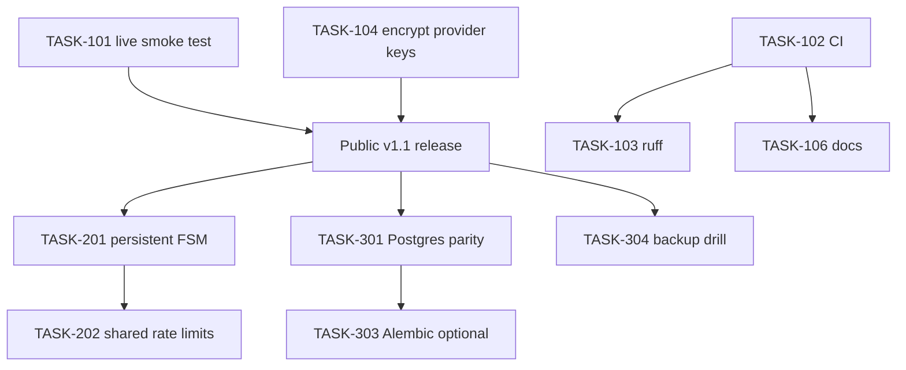

# Product Roadmap

Status vocabulary: **Shipped** (in `main` today) · **Next** · **Later** · **Idea** (not committed).
Priority: **P0** critical · **P1** high · **P2** medium · **P3** future.

Every item lists dependencies, complexity (S/M/L), user value, acceptance
criteria and test requirement. Nothing here is invented scope for its own sake —
"Next" items come from `HANDOFF.md` open work and the code's documented trade-offs.

---

## Release map

| Release | Theme | State |
| --- | --- | --- |
| **v1.0 — MVP** | Chat, conversations, personality, memory, tools, model selection, admin, FA/EN, Docker | **Shipped** |
| **v1.1 — Verification & polish** | Live smoke test, provider encryption decision, docs package | **Next** |
| **v1.2 — Durability** | Persistent FSM storage, shared rate-limit store | Later |
| **v1.3 — Scale & ops** | Postgres parity, metrics endpoint, structured error reporting | Later |
| **v2.0 — Reach** | Non-OpenAI providers, richer media-adjacent features | Idea |

---

## Phase 0 — Shipped baseline (v1.0)

All items below are **implemented and covered by the 32-test suite** unless noted.

| ID | Feature | Pri | Deps | Cx | Acceptance (summary) |
| --- | --- | --- | --- | --- | --- |
| TASK-001 | Config + validation + logging | P0 | — | S | Boots with only `BOT_TOKEN`; warns on missing AI key |
| TASK-002 | SQLAlchemy models + migration runner | P0 | TASK-001 | M | Fresh DB reaches `schema_version=2`; re-run is a no-op |
| TASK-003 | Repositories with ownership scoping | P0 | TASK-002 | M | Foreign ids return `None`; test T-09 |
| TASK-004 | Bilingual catalogs + loader | P0 | TASK-001 | M | Identical key sets; formatting works |
| TASK-005 | Provider abstraction + registry | P0 | TASK-001 | M | Env provider always present; admin rows merged |
| TASK-006 | Chat engine + prompt builder | P0 | TASK-003/005 | L | Context, temperature, persistence, usage log |
| TASK-007 | Tools service (5 families) | P1 | TASK-006 | M | One-shot, no history writes |
| TASK-008 | Keyboards/views/UI helpers | P1 | TASK-004 | M | Every screen reachable by taps |
| TASK-009 | User middleware | P0 | TASK-003 | S | Injects user/lang/is_admin; blocks blocked users |
| TASK-010 | 13 handler routers | P0 | TASK-006/008 | L | All callbacks wired; no dead buttons |
| TASK-011 | Admin panel | P1 | TASK-003/005 | M | Stats, health, providers, block, broadcast |
| TASK-012 | Docker + Compose + docs | P1 | TASK-001 | S | One-command deploy with volume |

---

## Phase 1 — v1.1 Verification & hardening (Next)

| ID | Item | Pri | Deps | Cx | Why | Acceptance | Tests |
| --- | --- | --- | --- | --- | --- | --- | --- |
| TASK-101 | Live end-to-end smoke test with a real token + key | **P0** | keys from operator | S | The only unverified path is a real provider call; code is unit-tested with a fake | `/start` → language → message → reply persisted; one `/admin` stats read | Manual checklist in [test-plan](../testing/test-plan.md#6-smoke-scenarios-manual-real-bot) |
| TASK-102 | CI workflow (tests on push/PR) | P1 | — | S | Prevents broken `main` | ~~Workflow file exists~~ file added (`.github/workflows/ci.yml`); **must still pass on a PR** | Self-verifying |
| TASK-103 | Add `ruff` + config; fix findings | P1 | TASK-102 | M | No style gate exists today | `ruff check src tests` clean | CI |
| TASK-104 | Encrypt `ai_providers.api_key` at rest | P1 | key management decision | M | Plaintext keys in SQLite is the top known risk | Admin add/delete works with ciphertext; no plaintext column value | New test with a fake cipher |
| TASK-105 | `LICENSE` file to match the README badge | P3 | — | S | README claimed MIT without a licence | Done — MIT file added 2026-11-16 | — |
| TASK-106 | Documentation package (this directory) | P1 | — | L | Portable blueprint for any agent | Done 2026-11-16 — `docs/`, `artifacts/`, `prompts/`, `skills/`, `templates/`, `manifest/` | `manifest/generation-status.json` |

---

## Phase 2 — v1.2 Durability (Later)

| ID | Item | Pri | Deps | Cx | Why | Acceptance | Tests |
| --- | --- | --- | --- | --- | --- | --- | --- |
| TASK-201 | Redis FSM storage (or SQL-backed `Storage`) | P2 | Redis service | M | Multi-step flows die on restart (`MemoryStorage`) | Kill the process mid-rename; after restart the flow resumes or cleanly resets | Integration test with fake storage |
| TASK-202 | Shared rate-limit buckets | P2 | TASK-201 or DB table | M | In-memory window resets and cannot span processes | Two processes share the counter | Unit test on the store |
| TASK-203 | Archived-conversations pagination | P3 | — | S | Archived view has no paging | Page controls appear when needed | Repository test |
| TASK-204 | Export conversation as JSON | P3 | — | S | Users may want machine-readable history | Valid JSON with roles/timestamps | Parser test |
| TASK-205 | Per-user provider quota display | P3 | — | S | Cost transparency | Screen shows remaining daily requests | — |

---

## Phase 3 — v1.3 Scale & operations (Later)

| ID | Item | Pri | Deps | Cx | Why | Acceptance |
| --- | --- | --- | --- | --- | --- | --- |
| TASK-301 | PostgreSQL parity verification | P2 | driver env var | M | `DATABASE_URL` claims portability; untested on PG | Suite passes against PG in CI service container |
| TASK-302 | Metrics endpoint or periodic log summary | P2 | host access | M | No observability beyond logs | Requests/failures/latency exposed |
| TASK-303 | Alembic baseline (optional) | P3 | TASK-301 | M | Custom runner is sufficient today, but Alembic helps schema review | `alembic upgrade head` on an empty DB equals ORM schema |
| TASK-304 | Backup automation + restore drill | P2 | host access | S | RPO/RTO currently undefined | Documented cron + verified restore |
| TASK-305 | Webhook mode (optional) | P3 | public HTTPS | M | Polling is fine for one instance | Webhook + secret header validation |

---

## Phase 4 — v2.0 Reach (Idea, not committed)

| ID | Item | Pri | Rationale / caution |
| --- | --- | --- | --- |
| TASK-401 | Additional native provider classes (Anthropic Messages API) | P3 | `AIProvider` is designed for this; adds a second request shape |
| TASK-402 | Voice note transcription | P3 | Needs file download, storage and a transcription provider; changes privacy posture |
| TASK-403 | Image understanding | P3 | Same media pipeline concern |
| TASK-404 | Inline mode (`@bot query`) | P3 | Requires public results and rate-limit rethink |
| TASK-405 | Group support | P3 | Breaks single-user data scoping assumptions; would need room ownership model |
| TASK-406 | Mini App dashboard | P3 | Adds a web surface + auth, contradicting "Telegram-only" boundary |

---

## Dependency graph (next two releases)

---

## Prioritisation rationale

1. **Verification before features.** The only unproven path is a real provider call;
   shipping more surface without that smoke test multiplies unverified behaviour.
2. **Security debt next.** Plaintext provider keys are the highest-severity known
   issue and cheap to fix once a key-management decision is made.
3. **Durability after that.** Persistent FSM and shared limits only matter when the
   bot restarts often or runs more than one process — neither is true today.
4. **Scale last.** Postgres and metrics are insurance, not user value at the current
   single-operator scale.
5. **Media and group features are explicitly deferred** because they change the
   privacy model and the data-scoping assumptions that keep the code simple.

---

## Release acceptance gates (all releases)

A release may be tagged only when:

- [ ] `pytest -q` passes (31+ tests, no xfail additions without a linked issue).
- [ ] Both locale catalogs have identical keys.
- [ ] `python run.py` boots and logs `Services ready`.
- [ ] A fresh database migrates to the current `SCHEMA_VERSION`.
- [ ] No secret appears in `git diff` or logs.
- [ ] `HANDOFF.md` is updated with the new state and next steps.
