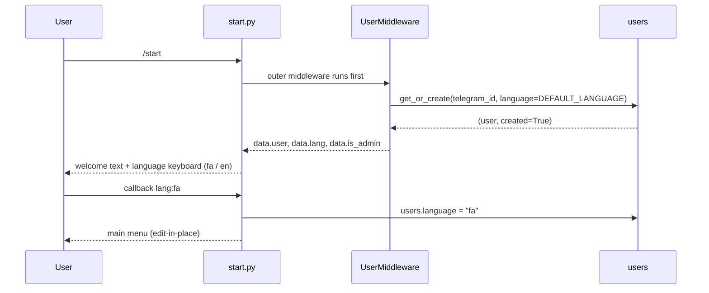
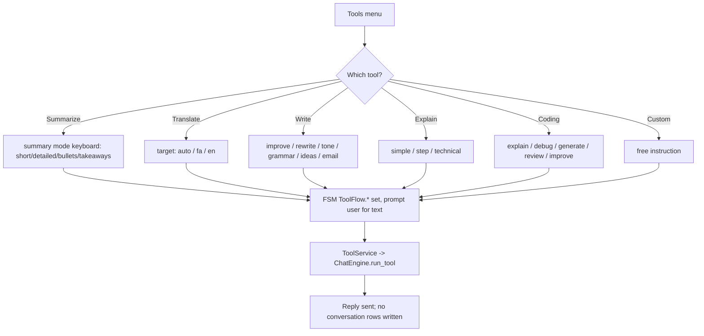

# User Journeys

Each journey states starting conditions, actions, system responses, success and
failure conditions, and permission requirements. Handlers and states referenced
here are real symbols in `src/`.

Legend: **FR-*** = requirement id ([functional-requirements](functional-requirements.md)),
**T-*** = test case ([test-cases](../testing/test-cases.md)).

---

## J0 — First run by the operator (deployer)

**Start:** fresh clone, no `.env`.
**Permission:** filesystem access; no bot user yet.

| Step | Actor action | System response |
| --- | --- | --- |
| 1 | `pip install -r requirements.txt` (or `docker compose build`) | aiogram, SQLAlchemy, aiosqlite, pydantic-settings, httpx installed |
| 2 | `cp .env.example .env`, set `BOT_TOKEN`, `AI_API_KEY`, optionally `ADMIN_IDS` | — |
| 3 | `python run.py` | `setup_logging`, `validate_runtime()` warnings printed for missing optional keys |
| 4 | — | If `BOT_TOKEN` empty/`TOKEN`: `SystemExit` with a copy-paste instruction |
| 5 | — | `run_migrations()` creates `./data/bot.db`, applies schema v2, logs `Database schema ready` |
| 6 | — | `bootstrap()` builds repositories, registry, engine, tools, GitHub client; logs `Services ready` |
| 7 | — | `dp.start_polling` begins; logs `Starting polling…` |

**Success:** `/start` returns the language chooser.
**Failure:** wrong `DATABASE_URL` → SQLAlchemy error at boot; invalid token → aiogram `Unauthorized` during polling; both leave a readable log line.
**Related:** FR-CFG-001, [development-environment](../devops/development-environment.md).

---

## J1 — Onboarding (new user)

**Start:** first `/start`.
**Permission:** any Telegram user.

| Step | Action | Response |
| --- | --- | --- |
| 1 | `/start` | Localized welcome (`start.welcome`) + language chooser |
| 2 | Tap **فارسی** or **English** | `users.language` updated; main menu rendered |
| 3 | Tap **شروع گفتگو / Start chat** | Chat state set; bot prompts for a message |
| 4 | Send text | Typing indicator, AI reply, both turns stored |

**Success:** user reaches the main menu with the chosen language applied to UI *and*
AI replies (`UserSettings.response_language='auto'` follows the detected input language).
**Failure:** blocked user → middleware answers `start.blocked` and stops dispatch.
**Edge cases:** user already exists → no duplicate row (`telegram_id` unique);
language switch mid-session is allowed at any time via Settings/Language.
**Tests:** T-01, T-02 (`tests/test_database.py`).

---

## J2 — Core chat with context

**Start:** main menu → Chat, or any plain text after onboarding.
**Permission:** non-blocked user.

| Step | Action | Response |
| --- | --- | --- |
| 1 | Send "این مقاله را خلاصه کن" | `ChatEngine.respond()` builds the system prompt (personality, style, tone, language, emoji, memories, persona) |
| 2 | — | Last `MAX_CONTEXT_MESSAGES` turns loaded from `messages` |
| 3 | — | Provider called with temperature derived from creativity |
| 4 | — | Reply converted Markdown→escaped HTML, split at 3500 chars, sent |
| 5 | — | `user` and `assistant` rows inserted, conversation `updated_at` touched, usage logged with latency and tokens |

**Success:** contextual reply; rows persisted; usage logged with `success=1`.
**Failure:** provider error → localized `errors.ai` message with the upstream
detail (truncated to 300 chars); usage logged with `success=0`; **no** history rows
written (documented in [ADR-004](../architecture/decisions/ADR-004-chat-execution-and-context.md)).
**Edge cases:** empty message → ignored by the text filter; message > 4096 chars →
Telegram rejects before the handler; concurrent sends → per-user `asyncio.Lock` serialises.
**Tests:** T-03, T-04, T-05.

---

## J3 — One-shot tool use

**Start:** Menu → Tools → choose a tool.
**Permission:** non-blocked user.

**Success:** output is a pure transformation of the input, replied in the user's UI language.
**Failure:** provider error surfaces `errors.ai`; no partial state.
**Edge cases:** `translate/auto` flips direction based on `detect_language()`;
very long input is truncated by the message limit; `/cancel` clears the FSM state.
**Tests:** T-06 (no history written), T-07 (tool prompt composition).

---

## J4 — Personality, tone and style

**Start:** Menu → Personality.
**Permission:** non-blocked user.

| Step | Action | Response |
| --- | --- | --- |
| 1 | Tap a preset (10 available) | `user_settings.personality` stored |
| 2 | Tap a style (6) / tone (5) / creativity (3) | Stored; temperature follows creativity (`low` 0.2 / `balanced` 0.7 / `high` 1.1) |
| 3 | Tap **Custom instructions** | `PersonaFlow.custom` state; next message stored as `custom_instructions` |

**Success:** the next chat reply reflects the new composition.
**Failure:** unknown preset value → `build_system_prompt` falls back to `friendly`.
**Edge cases:** switching personality with `custom` selected keeps both custom text
and preset (`prompts.py` appends custom instructions after the preset line unless
personality is exactly `custom`).
**Tests:** T-08 (persona instructions reach the system prompt).

---

## J5 — Conversation management

**Start:** Menu → Conversations (paginated, 5 per page).
**Permission:** owner only; every repository call passes `user_id`.

| Action | Callback | Result |
| --- | --- | --- |
| Create | `conv:new` | New conversation, becomes `current_conversation_id` |
| Open | `conv:open:{id}` | Ownership checked; becomes current; summary shown if any |
| Pin / unpin | `conv:pin:{id}` | `is_pinned` toggled, list re-rendered |
| Rename | `conv:rn:{id}` → text | `ConversationFlow.rename`; title updated |
| Search | `conv:search` → text | `ConversationRepository.search()` over title |
| Summarise | `conv:sum:{id}` | `ChatEngine.summarize_conversation()` persists 3–5 sentence summary |
| Export | `conv:exp:{id}` | `.txt` document with role-tagged transcript |
| Archive | `conv:arch:{id}` | Hidden from list; if it was current, current cleared |
| Unarchive | `conv:unarch:{id}` | Restored |
| Delete | `conv:del:{id}` → confirm `conv:delok:{id}` | Cascade delete of messages |

**Success:** list state matches the database after every action.
**Failure:** foreign id → repository returns `None`, handler answers silently (no data leak).
**Edge cases:** deleting the current conversation clears `current_conversation_id`;
pagination clamps to the valid page range.
**Tests:** T-09 (isolation), T-10 (pin/persona/model/search).

---

## J6 — Model selection

**Start:** Menu → Model.
**Permission:** non-blocked user.

1. Keyboard lists `(provider, model)` pairs from `ProviderRegistry.models()`.
2. Tap a model → `user_settings.model` stored.
3. Replies resolve through `registry.resolve(prefs.model)`; conversation-level
   `model` override wins; `auto_routing` (if enabled) runs `ModelRouter.choose()`.
4. **Failure:** stored model no longer offered → registry falls back to the first
   provider; no crash.

**Tests:** T-11 (conversation model override), T-12 (router preference/fallback).

---

## J7 — Prompt Studio

**Start:** Menu → Prompt Studio.
**Permission:** non-blocked user.

| Step | Action | Response |
| --- | --- | --- |
| 1 | New prompt | `PromptFlow.new`; asks title then body |
| 2 | Choose category | `prompts.category` stored |
| 3 | View list / detail | Paginated, filterable by category |
| 4 | Edit body | `PromptFlow.edit` |
| 5 | Run | Sends body as a one-shot instruction, output not persisted |
| 6 | Delete | Confirm, then cascade-safe delete |

**Failure:** duplicate titles are allowed (no unique constraint by design; only
persona names are unique per user).
**Tests:** T-13 (prompt CRUD + categories).

---

## J8 — Admin operations

**Start:** `/admin` (or menu if `is_admin`).
**Permission:** Telegram id present in `ADMIN_IDS`; non-admins get `admin.denied`.

| Action | Callback / command | Effect |
| --- | --- | --- |
| Stats | `adm:stats` | Users (total/blocked/active 24h), messages, requests today, token totals |
| Health | `adm:health` | `ProviderRegistry.health()` per provider |
| Providers | `adm:providers` | List, `adm:addprov` (name/url/model/key), `adm:delprov:{id}` |
| Limits | `adm:limits` | Displays rate limit and daily cap from config |
| Broadcast | `adm:broadcast` → text | Sends to every user id, paced, reports success/failure counts |
| Block | `/block <id>` | `users.is_blocked = True` |
| Unblock | `/unblock <id>` | `is_blocked = False` |

**Failure:** broadcast to a user who blocked the bot → caught per-send, counted as failed.
**Edge case:** adding a provider with an invalid URL → stored, but `health` reports failure.

---

## J9 — Developer profile (GitHub)

**Start:** Menu → Developer (or `menu:about` → About bot).
**Permission:** any user.

1. `GitHubClient.profile()` / `.repos()` called with 15-minute TTL cache.
2. Repo list paginated (`gh:popular`, page callbacks).
3. **Failure:** network error, 403/429 or 404 → `None`/`[]`, UI shows `gh.unavailable`.
4. **Token:** optional; raises rate limit only.

---

## J10 — Blocked user

**Start:** any update from a blocked user.
**Response:** middleware replies `start.blocked` (`show_alert` for callbacks) and
returns `None`, so **no handler runs** — including AI calls.
**Recovery:** admin `/unblock <telegram_id>`.
