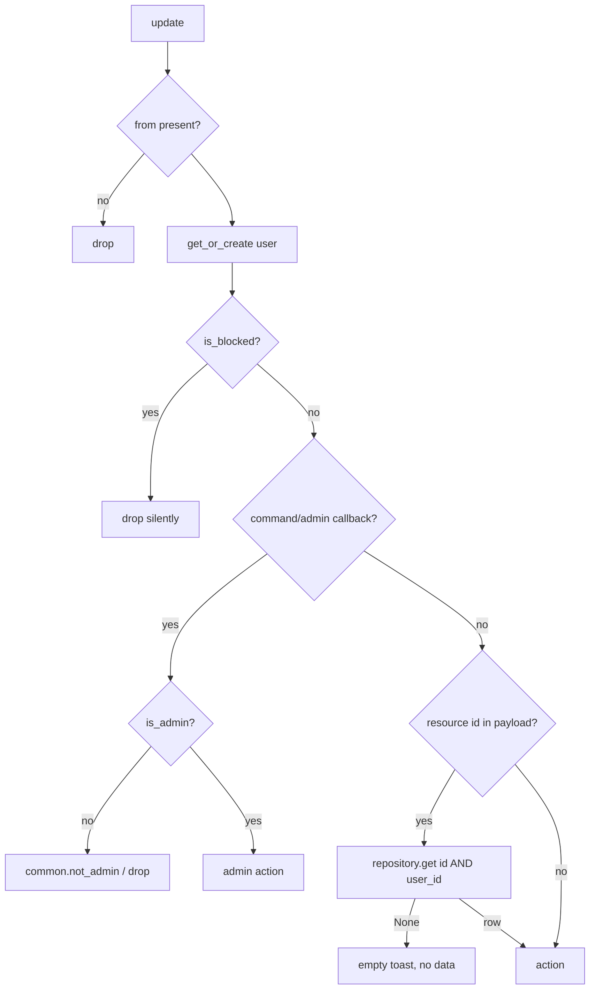

# Authentication & Authorization (Security View)

The functional contract is in [api/authentication](../api/authentication.md); this
document covers the security properties, the failure modes, and how to test them.

## 1. Authentication properties

| Property | Implemented? | Detail |
| --- | --- | --- |
| Identity assertion | ✔ | Telegram `from.id`, signed transport |
| Credential storage for users | n/a | users have no password |
| Session lifetime | n/a | each update is independent |
| Bot authentication | ✔ | `BOT_TOKEN` in `.env` |
| Token rotation path | ✔ | BotFather revoke + restart |
| MFA | n/a | Telegram account's own MFA applies |
| Rate limit on auth attempts | n/a | no auth endpoint to brute force |

**Security consequence:** the bot's security level equals the operator's Telegram
account security plus `.env` hygiene. There is nothing to brute-force, and nothing to
phish except the bot token.

## 2. Authorization model

## 3. Enforcement points (code map)

| Control | Location | Notes |
| --- | --- | --- |
| block gate | `bot/middlewares/user.py` | returns `None` before any handler |
| admin check (commands) | `bot/handlers/admin.py` | `/admin`, `/block`, `/unblock` |
| admin check (callbacks) | `bot/handlers/admin.py` (`adm:*`) | duplicated deliberately |
| ownership (conversations) | `database/repositories/chats.py` | `get(id, user_id)` |
| ownership (personas) | `database/repositories/personas.py` | id + `user_id` |
| ownership (prompts) | `database/repositories/prompts.py` | id + `user_id` |
| ownership (messages) | via conversation | never queried by bare id from a handler |
| memory scoping | `database/repositories/memory.py` | always `user_id` |

## 4. Known authorization weaknesses

| # | Weakness | Exploitability | Impact | Recommendation |
| --- | --- | --- | --- | --- |
| W1 | Block is per Telegram id; a new account bypasses it | trivial for the user | free usage again | accept (documented); or gate by device/phone (not possible) |
| W2 | No admin action audit trail | insider | untraceable changes | TASK-106 |
| W3 | Admin can add a provider whose `base_url` points anywhere | admin-only | SSRF-like egress | validate scheme/host allow-list |
| W4 | silent toast hides genuine "row disappeared" races | none | UX only | — |
| W5 | Admins can broadcast to all users without confirmation beyond one button | admin | user annoyance | add a typed confirmation for >N users |

## 5. What is *not* a weakness (and why)

| Concern | Why it is not exploitable here |
| --- | --- |
| Callback payload tampering | Telegram does not let a user send arbitrary callback data to the bot; it must come from a keyboard the bot sent. Even so, ids are re-validated. |
| Session fixation / CSRF | no cookies, no browser session |
| Password spraying | no passwords |
| JWT confusion | no JWTs |
| Prompt injection reaching other users | prompts are per-request and per-user; no shared memory |
| Path traversal | no user-supplied file paths |
| XXE / SSTI | no XML, no template engine (only `str.format` with dict values) |

## 6. Verification checklist (manual + automated)

| # | Check | How |
| --- | --- | --- |
| A1 | Blocked user gets no response | block a test account, send `/start` |
| A2 | Non-admin `/admin` is inert | send as non-admin |
| A3 | Forged `adm:stats` callback | requires tooling; covered by code review |
| A4 | Foreign conversation id | `conv:open:<id+1>` returns not found |
| A5 | Foreign persona delete | `cps:del:<id+1>` returns not found |
| A6 | Ownership SQL review | grep repositories for `select(` without `user_id` |
| A7 | Admin list parsing | `ADMIN_IDS="1, 2 ,3"` → all recognised |

**Automated coverage today:** none of A1–A7 is a test. This is the largest security
testing gap and is listed in [security testing](security-testing.md).

## 7. Hardening recommendations (ordered)

1. Add handler tests for A4/A5 (highest value, low effort).
2. Add an admin audit table (who, what, when) — TASK-106.
3. Validate provider `base_url` (scheme `https`, no localhost/RFC1918 unless explicitly
   allowed) — TASK-106.
4. Make blocking time-bounded/optional-blocklist export.
5. Document the "one deployment = one operator" assumption in the deployment guide so
   nobody runs a shared public bot without reviewing limits.
