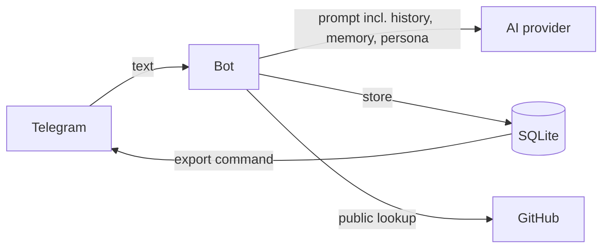

# Data Protection

## 1. What personal data exists

| Data | Table | Why stored | Retention |
| --- | --- | --- | --- |
| Telegram id | `users.telegram_id` | identity | indefinite (no purge feature) |
| Display name/username | `users.first_name`, `username` | greet the user | indefinite |
| UI language | `users.language` | UI rendering | indefinite |
| Chat text | `messages.content` | conversation continuity | indefinite unless the user clears it |
| AI replies | `messages.content` | same | same |
| Persona instructions | `personas.instructions` | user feature | until deleted by user |
| Saved prompts | `prompts.body` | user feature | until deleted |
| Memory facts | `user_memory` | personalisation | until cleared |
| Usage metadata | `usage_logs` | quota, cost, admin stats | indefinite |

**Not stored:** phone number, email, contacts, location, files, voice, payment data,
IP addresses (beyond what the host's network stack and Docker logs may capture).

## 2. Data flow

### 2.1 What leaves the deployment

When a user sends a message, the provider receives:

- the composed system prompt (language, personality/style/tone, custom instructions,
  persona instructions if assigned, up to 20 memory facts, conversation summary),
- the last `MAX_CONTEXT_MESSAGES` turns of that conversation,
- the new message.

It **does not** receive the Telegram id, username, or any other user's data. Provider
retention/training policies are outside this project's control — the operator must
choose a provider whose terms they accept.

### 2.2 What stays local

Everything else: settings, personas, prompts, memory, usage logs, the SQLite file.

## 3. Protection controls (implemented)

| Control | Where | Effect |
| --- | --- | --- |
| Owner-scoped queries | repositories | no cross-user reads |
| HTML escaping before markdown conversion | `utils/text.py` | model output cannot inject markup |
| Plain-text fallback on parse errors | `bot/ui.py` | never renders raw HTML after a failure |
| No secrets in messages | reviewed paths | keys never reach a chat |
| No chat text in logs | logging calls | operator logs contain metadata only |
| Export to file | `conv:exp` | user data portability |
| Clear history / reset settings | handlers | user-initiated deletion of content |
| `.env` ignored | `.gitignore` | secrets out of git |

## 4. Protection gaps (honest list)

| Gap | Consequence | Severity |
| --- | --- | --- |
| No encryption at rest | anyone with the DB file reads all chats | High |
| No account deletion | a user cannot erase their identity and usage rows | Medium |
| `SET NULL` audit rows retain history after (theoretical) user deletion | residual metadata | Low |
| No retention/rotation policy | DB grows unbounded; old chats persist | Medium |
| Backups are plain copies | backup leaks are chat leaks | High |
| Docker logs may include Telegram update metadata at DEBUG | minor | Low |

## 5. User-facing privacy stance

The bot offers a `set:privacy` screen explaining what is stored and how to delete it.
Claims made there must stay true; currently it can honestly say:

1. Chats are stored on the operator's server to provide context.
2. Clearing a conversation deletes its messages.
3. Memories and personas can be deleted individually.
4. Messages are sent to the configured AI provider for processing.
5. There is **no full account deletion** — this must not be implied.

## 6. Operator obligations

1. Restrict filesystem access to `data/bot.db` and `.env` (mode `600`, dedicated user).
2. Encrypt backups or store them where only the operator can read them.
3. Choose an AI provider whose data policy is acceptable.
4. Do not enable `DEBUG` logging in production without reviewing the output.
5. If a user requests erasure, run the documented SQL (see
   [backup-recovery](../devops/backup-recovery.md#5-manual-erasure-user-deletion-requests)) and note that
   `usage_logs` will retain nulled rows.

## 7. Regulatory note (no overclaiming)

The project does **not** claim GDPR/CCPA/DPDP compliance. It provides mechanisms
(export, delete, minimal collection) that an operator can use to meet obligations, and
it documents the gaps. Compliance depends on the operator's jurisdiction, hosting and
provider choice.

## 8. Review triggers

Changing the provider payload, adding a new stored field, adding analytics, or adding
a third-party API all require updating this document and the privacy screen text.
