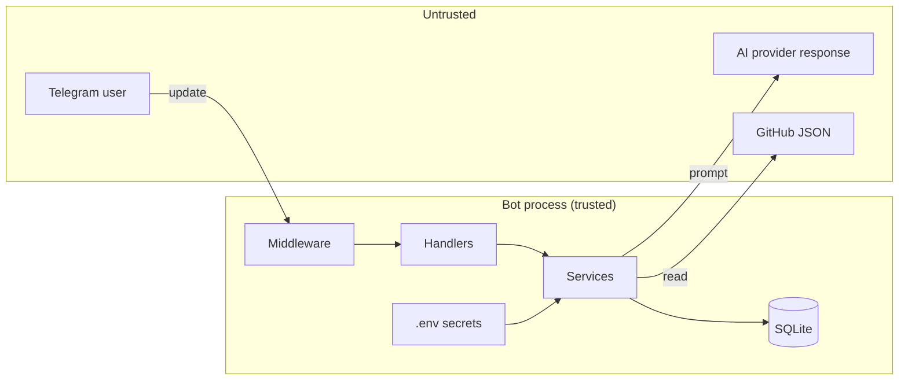

# Security Architecture

Status: describes the **implemented** posture. Controls that do not exist are labelled
as gaps, never as aspirations.

## 1. Assets

| Asset | Sensitivity | Where it lives |
| --- | --- | --- |
| `BOT_TOKEN` | Critical — full bot control | `.env` |
| `AI_API_KEY` | High — billing abuse | `.env` |
| Runtime provider keys | High | `ai_providers.api_key` (plaintext) |
| Conversation content | High — personal data | `messages.content` |
| Memory facts | High — personal data | `user_memory` |
| Persona instructions | Medium | `personas.instructions` |
| `GITHUB_TOKEN` | Low | `.env` |
| Usage logs | Medium — behavioural metadata | `usage_logs` |
| Admin allow-list | Medium — privilege | `ADMIN_IDS` |

## 2. Trust boundaries

| Boundary | Threat | Control |
| --- | --- | --- |
| Telegram → bot | spoofed identity | Telegram signs updates; bot token authenticates |
| AI response → Telegram HTML | injection into HTML parse mode | escape **before** markdown conversion |
| AI response → DB | stored content later re-rendered | same escaping on every render path |
| GitHub JSON → UI | reflected content | rendered as plain text inside escaped HTML |
| Admin input → provider config | SSRF-ish base URL | admin-only; URL not validated as internal — gap |
| Process → disk | file read by host user | filesystem permissions only |
| `.env` → git | accidental commit | `.gitignore` + CI secret scan (workflow provided) |

## 3. Controls implemented

### 3.1 Identity and authorization
- Identity from Telegram only (`from.id`), resolved/created in `UserMiddleware`.
- `is_blocked` gate short-circuits dispatch.
- `Settings.is_admin()` for `/admin`, `/block`, `/unblock` and again inside every
  `adm:*` callback.
- Every user-scoped repository call filters by `user_id` (IDOR resistance).

### 3.2 Input handling
- Telegram caps text at 4096 chars; nothing larger enters the pipeline.
- Callback identifiers are integers; unknown payloads are acknowledged and ignored.
- Repository-level validation for persona name/instructions length and prompt title.
- No `eval`, no `exec`, no `pickle`, no shell calls anywhere in `src/`.

### 3.3 Output handling
- `markdown_to_telegram_html()` escapes `& < >` first, then converts a whitelist of
  Markdown constructs. Raw model HTML cannot reach the client as markup.
- `TelegramBadRequest` triggers a plain-text resend — never a raw-HTML resend.

### 3.4 Secrets
- Primary secrets only from env; `.env` ignored by git; `.env.example` empty.
- No secret is logged; error text truncated to 300 chars.
- Admin-added provider keys are plaintext in SQLite — accepted risk (ADR-005).

### 3.5 Data
- Owner-scoped queries; no cross-user read path, including for admins.
- Cascades on user-owned tables (ORM-level).
- Export exists (`conv:exp`) so users can take their data out.

### 3.6 Dependency hygiene
- Six runtime packages, all mainstream and pinned to minor ranges.
- CI workflow runs `pip-audit` (provided, not yet executed in the repo).

## 4. Missing controls (real gaps)

| # | Gap | Risk | Severity | Planned |
| --- | --- | --- | --- | --- |
| G1 | Provider keys plaintext at rest | DB/backup leak exposes keys | High | TASK-104 |
| G2 | No encryption at rest for messages/memory | disk/backup leak exposes chats | Medium | not scheduled |
| G3 | No account deletion / data purge | privacy requests cannot be honoured fully | Medium | TASK-204 |
| G4 | No global exception handler | silent failures, poor UX | Low | TASK-102 |
| G5 | No audit log of admin actions | abuse is untraceable | Medium | TASK-106 |
| G6 | No `base_url` validation for admin providers | admin could configure an internal address | Low (admin-only) | TASK-106 |
| G7 | Container runs as root | local privilege escalation | Low | devops hardening |
| G8 | No secret scanning executed yet | leaked key goes unnoticed | Medium | `security.yml` |
| G9 | No CSRF-equivalent concern (bot), but no replay protection beyond Telegram | duplicate update replay is bounded by idempotent writes | Low | — |

## 5. Security-relevant design decisions

| Decision | Security implication |
| --- | --- |
| Long polling, no inbound port | eliminates an entire class of network attack surface |
| Single process, one DB file | no distributed auth; but no defence in depth either |
| Escape-then-convert markdown | blocks HTML injection (the only injection vector) |
| Prompt text is code, not user data | users cannot inject system prompts through personas? — they **can**, by design (that is the feature); they cannot reach *other* users' prompts |
| Provider abstraction via base URL | admin-trusted configuration, not user-controlled |
| Persist-after-success | limits stale data; no partial-history inconsistency |

## 6. Security review triggers

A PR requires a security pass when it touches: authentication/authorization,
`markdown_to_telegram_html`, SQL construction, `Settings` fields, provider
configuration, file/network access, or anything under `database/`.

## 7. Related documents

- [Threat model](threat-model.md)
- [Authentication & authorization](authentication-authorization.md)
- [Data protection](data-protection.md)
- [Secrets management](secrets-management.md)
- [Security testing](security-testing.md)
