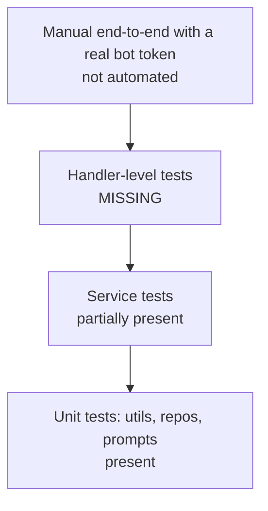

# Testing Strategy

## 1. Current state (verified)

| Fact | Value |
| --- | --- |
| Test files | 7 |
| Tests | **31** (all passing locally at the time of writing) |
| Frameworks | pytest, pytest-asyncio (`asyncio_mode = auto`) |
| Database in tests | in-memory SQLite (`sqlite+aiosqlite:///:memory:`) |
| Network in tests | none — the AI provider is faked |
| Coverage measurement | **none** |
| Lint/type gate | **none** |
| CI status | workflow provided, never executed |

Distribution:

| File | Tests | Covers |
| --- | --- | --- |
| `test_chat_engine.py` | 5 | turn persistence, context window, personas, tools, model override |
| `test_database.py` | 3 | user/settings creation, conversation isolation, memory upsert/clear |
| `test_localization.py` | 4 | catalog load, parity, formatting, fallback |
| `test_migrations.py` | 3 | fresh install, idempotency, legacy upgrade |
| `test_personas_prompts.py` | 3 | persona CRUD, default flag, prompt CRUD |
| `test_routing.py` | 3 | task classification, capability choice, fallback |
| `test_text.py` | 6 | split, escape, markdown→HTML, language detection |

## 2. Test pyramid (target)



| Level | Scope | Speed | Current |
| --- | --- | --- | --- |
| Unit | pure functions, repositories | ms | ✔ 20+ tests |
| Service | `ChatEngine`, `ToolService`, `ModelRouter`, registry | ms | ✔ 8 tests |
| Handler | aiogram update → reply | ms | ✘ |
| Contract | callback data ↔ handler | ms | ✘ |
| E2E | real Telegram + real provider | seconds | ✘ (manual only) |

The pyramid is **bottom-heavy by design** and lacks the middle. That middle is the
highest-value gap because it is where authorization regressions live.

## 3. What must be tested (risk-based)

| Risk | Why it matters | Level |
| --- | --- | --- |
| Cross-user data access | privacy breach | repository + handler |
| Prompt composition order | persona/memory/language mistakes are invisible until a user complains | service |
| Context window bound | cost blow-up | service (covered) |
| Migration idempotency | data loss on upgrade | repository (covered) |
| Catalog parity | broken UI in one language | unit (covered) |
| HTML escaping | injection | unit (covered) |
| Rate/daily limits | cost abuse | service/handler (gap) |
| Model routing fallback | requests failing in production | service (covered) |
| Provider error mapping | user sees garbage or nothing | service (gap) |
| Callback ownership | horizontal access | repository (gap) |

## 4. Test environment

```bash
python -m venv .venv && source .venv/bin/activate
pip install -r requirements-dev.txt
pytest -q            # 32 passed
```

- No `.env` needed: `Settings` is not required by the suite.
- No network: the fake provider implements `AIProvider`.
- Each test gets a fresh schema; nothing is shared.

## 5. Conventions

| Convention | Rule |
| --- | --- |
| Naming | `test_<behaviour>_<condition>` |
| Arrange | build rows explicitly; no seed files |
| Act | call one public service/repository method |
| Assert | assert the observable outcome (rows, returned value, raised error) |
| Async | plain `async def` (auto mode) |
| Fixtures | `db`, `session`, `user`, `conversation`, `fake_provider` in `conftest.py` |
| No mocks of SQLAlchemy | use the real in-memory DB |

## 6. Definition of done for a feature (testing part)

1. New behaviour has at least one test at the lowest level that can observe it.
2. A bug fix ships with a failing-then-passing test.
3. New locale keys are covered by the parity test automatically.
4. New columns are covered by a migration test.
5. No test depends on the network, the clock, or test order.

## 7. Not tested, and why

| Area | Reason | Mitigation |
| --- | --- | --- |
| aiogram handler dispatch | no harness; requires fabricated `Update` objects | add targeted handler tests (TASK-101) |
| Real provider responses | no API key in the dev environment | manual smoke test per release |
| Telegram HTML rendering | requires a client | escape tests approximate it |
| Broadcast at scale | needs many chats | sequential send + failure counting reviewed |
| Concurrency/lock behaviour | hard to test deterministically | code review + manual |

## 8. Roadmap for testing (ordered)

1. **TASK-101** — handler tests for ownership and admin gates (ST-01…ST-07).
2. **TASK-103** — `ruff` + optional `mypy` in CI.
3. Coverage reporting (`pytest --cov`) with a baseline, not a gate at first.
4. Contract test that every callback prefix in the JSON artifact matches a handler
   decorator.
5. Rate-limit tests (ST-30…ST-33).
