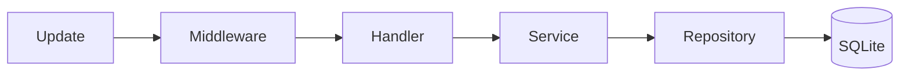

# <Document title>

> **Scope:** what this document covers, and what it deliberately does not.
> **Audience:** who should read it.
> **Status:** current | draft | depends on `[UNKNOWN — USER INPUT REQUIRED]`

## 1. Summary

Three sentences a busy reader can stop after.

## 2. Context

What exists today, grounded in code paths (`src/…`), schema (`artifacts/…`), or
configuration (`src/core/config.py`). No aspirational claims.

## 3. Detail

The body. Prefer tables over paragraphs for enumerable facts; prefer a diagram over a
paragraph for flows.



## 4. Trade-offs and limits

What this approach makes harder. Every "known gap" stays visible here rather than being
quietly omitted.

## 5. Verification

How a reader checks the claims:

```bash
pytest -q
python -m compileall -q src
```

## 6. References

- Related docs (relative links)
- ADRs
- External sources with URLs
